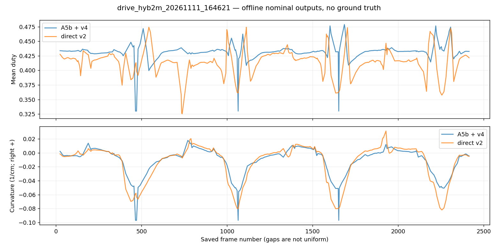
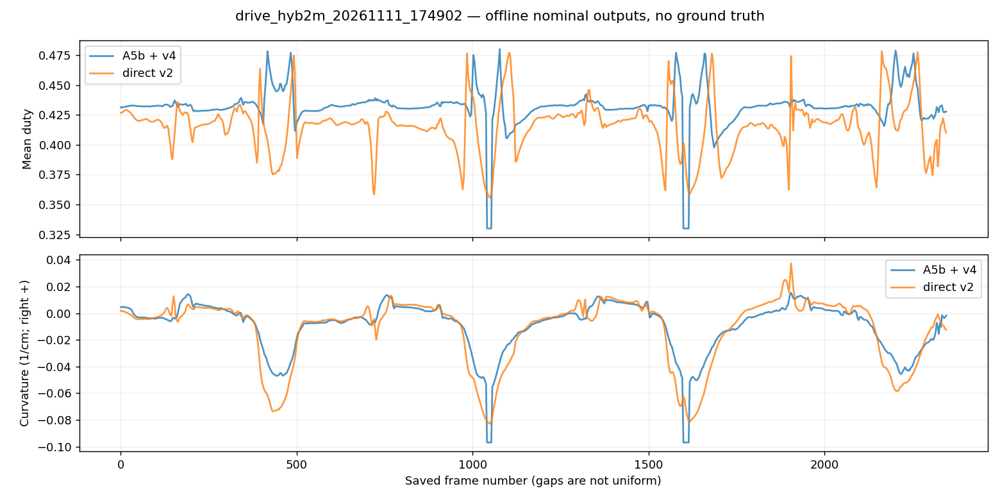

# DAgger 최종 보고 — 2026-11-12

최종 선정: **dagger_i1_v2**. 합격 기준 판정: **통과**. Pi 접속·배포·실차 주행은 하지 않았다.

## 교사 사전 확인

seed41의 10조건에서 variant3 교사 10/10 무침범 완주. 회복 중앙값0초는 코너 종료 시점에 이미 방향 오차5도 이내였다는 뜻이다. 교사 수정 조건에 해당하지 않아 교사와 기존36000장 정답은 유지했다.

## 반복 및 선정

개발은 seed42 기본4차량×양방향 realcam만 사용했다. 점수 우선순위는 무침범 수→최악 여유→회복 중앙값이다. seed41 학생 결과와 실차 사진은 선정에 사용하지 않았다.

| 후보 | 누적 전체 데이터 | 검증 MAE 전체/코너/복귀 | 개발 무침범 | 최악 여유 cm | 회복 중앙값 s |
|---|---:|---|---:|---:|---:|
| dagger_i1_v2 | 48000 | 0.07721/0.10469/0.07431 | 8/8 | 1.6736 | 1.512 |
| dagger_i2_v2 | 60000 | 0.07530/0.10744/0.07221 | 8/8 | 1.5521 | 1.818 |
| dagger_i2_v2_retry | 60000 | 0.07512/0.10824/0.07329 | 8/8 | 0.9354 | 2.052 |
| dagger_i3_v2 | 72000 | 0.07454/0.10674/0.07345 | 8/8 | 1.4809 | 2.016 |
| dagger_i3_v2_retry | 72000 | 0.07449/0.10669/0.07325 | 8/8 | 1.1848 | 1.872 |

| 반복 | 새 데이터 | 학생 주행 | 방향 오차 5도 초과 | 여유 -3~0cm | 안쪽 직선 |
|---|---:|---:|---:|---:|---:|
| 1 | 12000 | 6078 | 3038 | 291 | 1200 |
| 2 | 12000 | 9011 | 3258 | 722 | 1200 |
| 3 | 12000 | 12000 | 4212 | 156 | 1200 |

누적 전체 데이터 수에는 기존 검증/시험 9600장이 포함된다. 이 9600장은 학습 입력에서 제외했으므로 실제 학습량은 반복별 38400/50400/62400장이다. MAE는 정규화한 두 출력의 평균 절대 오차다.

DAgger 3회 완료, 개발 미개선에 대한 수정 2/2회 사용. 각 반복 새12시드×1000장, beta=0.5/0.25/0, 0.5초 구간 단위 정책 선택. 제어주기36ms, 실제 적용PWM에 교사 last_pwm을 맞추고 dither는 실행 정책에 대해 한 번만 갱신했다. 정답은 항상 교사다. 차체 여유 -3cm 미만/교차로35cm 미만 프레임은 저장하지 않았다. 내부 직선10%, 실제 코너 시작 에피소드 비율≥50% 검사. DART 없음.

학습은 직전 반복의 선택 모델에서 시작했고 기존 학습22시드와 누적 DAgger 자료만 사용했다. 기존 검증4/시험4시드는 학습에서 제외했다. 매 실행 내 체크포인트는 검증 MAE 최저를 사용하고 반복/수정 후보의 최종 선택은 개발 주행으로 했다.

준비 중 메타데이터 직렬화와 코너 에피소드 카운터 버그를 수정했다. dagger_1 및 dagger_1_v1의 불완전/명세 미달 수집과 중단 학습은 보존했지만 선정에서 제외했다. 이들은 개발 성능 튜닝 수정과 구분한다. 유효 자료는 dagger_1_v2, dagger_2_v2, dagger_3_v2다.

## 최종 seed41 비교

모델 고정 커밋 9d1a926을 푸시한 뒤에만 10조건 최종 비교를 실행했다. harsh 2조건은 별도 관찰이며 합격 판정에서 제외했다.

| 조건 | A5b 여유 cm | direct_v2 여유 cm |
|---|---:|---:|
| field_estimate/cw/realcam | 1.8373 | 2.1446 |
| weak_left_turn/cw/realcam | 2.0955 | 1.8431 |
| field_estimate/ccw/realcam | 1.4598 | 1.8173 |
| weak_left_turn/ccw/realcam | 0.7147 | 2.1305 |
| sluggish/cw/realcam | 1.3704 | 2.0323 |
| unequal_sides/cw/realcam | 1.0969 | 2.4469 |
| sluggish/ccw/realcam | 0.3119 | 2.0373 |
| unequal_sides/ccw/realcam | -2.7316 | 1.1416 |
| field_estimate/ccw/realcam_harsh | -12.0063 | -2.8258 |
| field_estimate/cw/realcam_harsh | -12.0861 | -1.7164 |

realcam 무침범 8/8(기준7), 회복 중앙값 1.458초(기준≤1.49), 조건별 최소 여유 차이 최악 -0.2524cm(기준≥-0.5).

| 모델/효과 | 완주 | 무침범 완주 | 회복 중앙값 s | 코너 안쪽 PWM<0.30 |
|---|---:|---:|---:|---:|
| baseline/realcam | 8/8 | 7/8 | 1.458 | 37.1% |
| baseline/realcam_harsh | 0/2 | 0/2 | 1.692 | 29.7% |
| new/realcam | 8/8 | 8/8 | 1.458 | 21.9% |
| new/realcam_harsh | 2/2 | 0/2 | 0.756 | 14.9% |

정답 감사: 유효 36개 샤드에서 총 360장을 저장 자세/실제 적용 PWM으로 재계산했고 최대 차이 2.8234e-8로 통과했다. 샤드 해시는 DAGGER_LABEL_AUDIT.json에 있다.

## 로컬 실차 사진 점검

2개 저장 주행, 1072장 모두 추론했다. 이미 정방향인 저장 사진에 추가 회전하지 않았다. 두 출력은 v4 할당기의 고정 명령256회 평균으로 명목 듀티·곡률로 비교했다. 실차 정답/재주행이 없으므로 정확도나 안전성 합격 판정에 쓰지 않는다. 저장 프레임 번호가 불연속이므로 급변은 인접 저장 사진 사이 차이이며 초당 변화율이 아니다. 코너 후보는 A5b 명목 |k|>0.02 기준으로 실제 코너 정답이 아니다.

| 주행 | 사진 수 | 평균 절대 곡률 차이 | 코너후보 곡률 차이 | A5b/new 곡률 급변 p95 |
|---|---:|---:|---:|---|
| drive_hyb2m_20261111_164621 | 289 | 0.00704 | 0.01778 | 0.01013/0.01246 |
| drive_hyb2m_20261111_174902 | 783 | 0.00679 | 0.01690 | 0.00318/0.00486 |

사진 비교 해석: 두 주행 모두 코너 후보에서 곡률 차이가 직선 포함 전체보다 컸고, 새 모델의 곡률 변화 p95도 A5b보다 컸다. 그래프상 주요 왼쪽 코너에서 새 모델은 더 큰 회전 곡률을 낸다. 따라서 수치가 정상 범위라는 사실을 실차 안정성 향상으로 해석하지 않는다.

| 주행 | 평균 듀티 절대 차이 | 새 듀티 범위 | 새 곡률 범위 /cm | 음수 속도 출력 | 곡률 변화 >0.02/cm |
|---|---:|---|---|---:|---:|
| drive_hyb2m_20261111_164621 | 0.02451 | 0.3253~0.4741 | -0.08199~0.03132 | 0 | 1 |
| drive_hyb2m_20261111_174902 | 0.02254 | 0.3558~0.4782 | -0.08288~0.03739 | 0 | 0 |

가장 큰 곡률 변화는 첫 주행의 저장 프레임393→408에서 -0.02419→-0.05198/cm(차이0.02779/cm)였다. 원본 두 사진을 직접 확인했으며 모두 코너 장면이다. 번호 간격15가 있는 저장 사진이므로 연속 제어 프레임의 급변이라고 단정하지 않는다. 두 그래프를 직접 검토했다.

출력 유한값 검사 및 raw 음수 속도/범위/큰 곡률 변화 통계는 DAGGER_PHOTO_CHECK.json에 있다. 급변이 오류인지는 정답 없이 확정하지 않는다. 원본 사진은 수정하지 않았으며 원본 해시와 프레임별CSV는 D:/autodrive_cnn/logs/dagger_photos에 보존한다.

## 산출물과 종료

최종 모델 models/direct_v2/policy.onnx, 출력정의/해시 policy.json, PyTorch↔OpenCV 검사 onnx_check.json. direct 모드 전용이다. 결정은 DECISIONS.md, 반복 전체 수치는 DAGGER_PROGRESS.json, 최종 수치는 DAGGER_FINAL_COMPARISON.json에 있다. 승인 범위의 작업을 마쳤으므로 중단한다. 7단계 배포·실차 시험은 수행하지 않았다.
