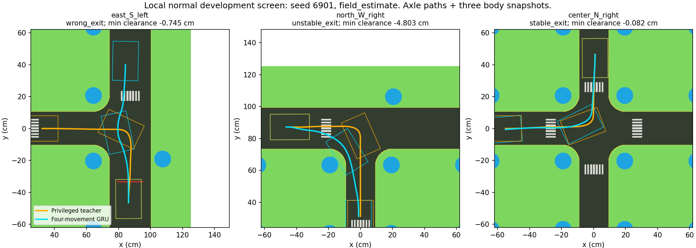

# 기존 모델의 28개 이동 정상 조건 개발 평가

고정한 시드 6901, 28개 이동, 차량 특성 3종의 84회 국소 주행이다. 학습 전에 기준 모델을 평가했다. 이 모델은 네 이동으로 학습했던 frozen CNN + GRU이며, 원래의 A5b + v4 또는 direct_v2 직접 평가와 구분한다.

- 전체 무이탈 안정 출구 성공: 23/84.
- 안정 출구 도달만 집계: 50/84. 이 중 27회는 이전 구간 차체 침범 때문에 실패다.
- 잘못된 출구: 25/84. 심한 이탈 0회, 불필요한 정지 사례 0회.
- 기존 학습 대상 네 이동: 무이탈 성공 5/12, 안정 출구 12/12.
- 같은 초기 자세를 사용한 오프라인 교사: 무이탈 성공 70/84. 교사는 성공하고 모델이 실패한 사례 53회, 모델만 성공한 사례 6회. 교사를 성능의 절대 상한으로 볼 수 없다.

교사의 14회 정상 실패는 0.003–0.040cm 수준의 작은 차체 침범도 포함한다. 작은 침범이라고 성공으로 다시 분류하지 않는다. 국소 초기 자세 복구와 영상 모델의 이동별 일반화 모두 남은 문제다.

28개 이동에서의 성적은 미학습 이동 확장과 직진 명령을 함께 시험한 결과다. 이전 네 이동의 숫자와 분리하여 본다. 하나의 공통 시드를 여러 이동·차량에 적용했으므로 84개의 독립 환경 시드로 해석하지 않는다. 강한 조명·교란·전체 경로·최종 시험 결과가 아니다.

학생 평가에서는 교사 호출이 발생하면 오류를 내도록 했으며, 저장한 교사 자리표시 라벨은 모두 무효 마스크다. 초기 자세 일치와 코드·모델·카메라 입력 파일 해시를 검증했다. 평가 조건, 성공 판정, 모델 가중치는 결과를 본 뒤 변경하지 않았다.

새 학습 모델의 대응 평가가 완료되기 전에는 개선을 주장하지 않는다.

## 교차로 종류별 진단

| 종류 | 무이탈 성공 | 잘못된 출구 |
|---|---:|---:|
| 중앙 사거리 회전 | 1/12 | 1 |
| 외곽 T자 진입 직진 | 12/24 | 12 |
| 외곽 T자 진입 회전 | 0/24 | 12 |
| 내부 도로에서 T자 합류 | 10/24 | 0 |

기존 네 이동 학습에는 외곽 T자 진입 회전이 없었다. 이번 24회가 모두 실패한 것은 이동 범위 확장의 필요성을 보여준다. 다만 데이터 범위만이 유일한 원인이라는 인과 증명은 아니다.

