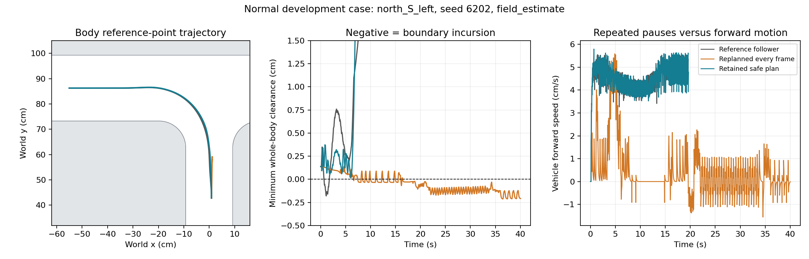

# 차체 경계 예측 교사의 개발 검증

목표는 계속 진행 중이다. 이번 단계는 오프라인 교사 제어의 진단이며 학생 CNN/GRU를 추가 학습하거나 교체하지 않았다. 정상 조건의 반복 정지 문제는 개선했지만 약한 복합 교란의 무이탈 성능은 아직 부족하다.

## 예측기와 정보 경계

현재 자세, 바퀴 속도, 이미 보낸 PWM 대기열, 할당기 잔여량, 명목 차량 파라미터와 참조 경로로 0.72초를 예측한다. 36ms 명령 처리와 20/16ms 물리 적분, 모터 문턱·포화·지연·응답을 그대로 재현했다. 미래 교란 일정이나 미래 난수는 예측 입력에 없다. 실제 차체 이동에서 바퀴 기반 이동을 뺀 최근 관측 잔차를 사용할 수 있지만, 아직 관측하지 않은 밀림의 방향·크기·종료 시점은 사용하지 않는다.

차체 세 종류 × 두 이동에서 명목 조건의 0.72초 자세·명령 예측이 실제 빠른 물리 실행과 정확히 일치했다. 명시적 PWM 계획 재생, 관측 잔차 계산, 미래 사건을 바꿔도 예측 입력이 바뀌지 않는 검사도 통과했다. 이는 명목 예측기의 구현 일치이지 교란 조건의 예측 보장이 아니다. 실제 계산 wall time은 시뮬레이션의 36ms에 추가하지 않았다. 오프라인 교사이며 Pi 실행 가능성은 검증하지 않았다.

## 계획을 반복해서 미루는 문제

초기 후보는 짧게 명령을 수정한 뒤 원래 교사로 돌아갈 계획을 매 프레임 새로 골랐다. 일부 상태에서는 실제 조향을 계속 미루고 정지를 반복했다. 안전한 기존 계획이 현재 상태에서도 유효하면 우선 실행하고, 남은 계획이 6프레임 이하이거나 안전하지 않으면 다시 계산하도록 바꿨다. 이 방식에도 정식 재귀적 안전성 보장은 없다.

사전 고정한 네 이동(north_S_left, east_W_left, center_E_right, south_N_right), seed6202, 차체 두 종류를 사용했다. 조건별 8회다. 실패 사례와 앞선 후보를 모두 보존했다.

| 후보 | 기본 무이탈 | 기본 안정 출구 | 기본 이동 정지 발생 | 약한 복합 무이탈 | 약한 복합 안정 출구 |
|---|---:|---:|---:|---:|---:|
| 수정 참조를 따르는 기존 교사 | 6/8 | 8/8 | 0/8 | 2/8 | 8/8 |
| 차체 예측 + 정렬 비용 | 6/8 | 6/8 | 3/8 | 2/8 | 7/8 |
| 최소 명령 수정 + 이전 계획 후보 | 6/8 | 7/8 | 1/8 | 2/8 | 8/8 |
| 위 방식 + 관측 밀림 외삽 | 6/8 | 7/8 | 1/8 | 2/8 | 8/8 |
| **안전한 이전 계획 우선 유지** | **8/8** | **8/8** | **0/8** | **2/8** | **8/8** |
| 위 방식 + 반응 지연 동안 밀림 유지 | 8/8 | 8/8 | 0/8 | 2/8 | 8/8 |

계획 유지 후보의 기본 통과 시간 중앙값은 20.11초였다. 최초 예측 후보는 29.02초였고 세 시간 초과가 기본/약한 조건에 걸쳐 발생했다. 다음 그림은 정상 초기 정렬 한 사례의 궤적, 경계 여유와 속도다. 이를 모든 조건의 개선으로 해석하지 않는다.

## 새 시드의 전체 정상 이동 검증

후보를 고정한 뒤 새 개발 시드 6301/6302 × 차체 3종 × 필수 28개 이동을 검사했다. 각 교사 168회, 쌍별 총 336회다.

| 교사 | 무이탈 | 안정 출구 | 이동 정지 발생 | 통과 시간 중앙값 |
|---|---:|---:|---:|---:|
| 기존 수정 참조 교사 | 168/168 | 168/168 | 0 | 19.241초 |
| 안전 계획 유지 교사 | 168/168 | 168/168 | 0 | 19.241초 |

새 시드에서는 기존 교사도 모두 통과했고 새 제어기의 개입은 168회 모두 0회였다. 따라서 이 표만으로 새 보정 기능의 일반적인 성능 향상을 주장할 수 없다. 알려진 취약 초기 상태의 개선과, 새 정상 사례에서 불필요한 개입을 하지 않았음을 관측한 것이다. 168개는 두 난수 시드를 이동·차체와 교차한 사례이며 168개의 독립 난수 실험이 아니다. 학생 모델이나 전체 연결 미션의 성공률도 아니다.

## 약한 교란이 남은 이유

관측된 밀림을 0.2초 시상수로 감소시키는 대신, 명령 처리+명목 구동 지연 동안 유지한 뒤 감소시키는 후보도 비교했다. 다음 36ms의 그림자 예측에서 밀림 활성 프레임 192개의 위치 오차 평균은 무보정 0.1275cm, 즉시 감소 0.0161cm, 유지 0.0100cm였다. 유지 예측의 95백분위 오차는 0.0374cm로 즉시 감소의 0.0270cm보다 컸다. 평균 개선을 모든 프레임 개선으로 표현하지 않는다. 실제 무이탈 횟수는 늘지 않았다.

계획 유지 교사의 약한 조건 실패 6개 중 2개는 첫 밀림 전이었다. 첫 침범 직전의 선택 계획은 5개에서 이미 음수 여유를 예측했다. 한 사례는 +0.00153cm를 예측했으나 실제 침범했다. 제한된 행동 후보에서 안전한 계획을 찾지 못한 경우와 미세한 동역학 예측 오차가 함께 남아 있다. 예측 정확도만 높이는 것으로는 충분하지 않다.

이전 전체 이동 교사의 약한 실패 86개도 정확히 재생했다. 첫 밀림 전 실패는 6개, 밀림 후 실패는 80개였다. 첫 관측이 실제 바퀴에 영향을 줄 수 있는 시간은 밀림 시작 후 약 0.107–0.247초였으며, 80개 모두 그 이후 처음 경계를 넘었다. 따라서 이 실패들을 지연만으로 물리적으로 불가능하다고 분류하지 않는다. 이 감사가 모든 상태에 복구 행동이 존재함을 증명하는 것도 아니다.

## 차체 전체의 연속 기하 검사

기존 1cm 간격 윤곽 표본 점수와 별개로, 채워진 차체 사각형과 도로의 둥근 사각형 장애물 사이 충돌을 검사했다. 외곽 도로의 볼록성과 차체/장애물 중심 사각형 사이 거리·분리축 검사를 사용한다. 양의 거리와 충돌 부호를 연속 윤곽에서 계산하며, 장애물 중심부의 깊은 침범량은 포화되므로 기존 심한 이탈의 크기 지표를 대체하지 않는다.

500개 임의 자세에서 0.025cm 간격의 조밀한 윤곽 검사와 충돌 부호가 일치했고 근처 거리 차이 경계도 통과했다. 1cm 표본 사이에 숨은 인공 침범을 검출하는 사례도 통과했다. 이번 후보 80회와 새 정상 비교 336회에서 기존 깨끗한 성공이 연속 윤곽 검사로 뒤집힌 사례는 0개였다. 시간축은 기존 물리 적분 시점에 고정돼 있으므로 연속 시간 전체의 무충돌 증명은 아니다.

## 다음 개발 우선순위

현재의 작은 안전 여유와 제한된 0.144초 행동 보정만으로 약한 교란을 해결하지 못했다. 경계 여유를 선행 확보하는 참조 경로·속도와 더 넓은 복구 행동 계획을 함께 검토한다. 예를 들어 기존 넓은 코너링 경로는 north_S_left에서 정적 최소 여유 약 0.50cm/최소 반경 20cm이며, 과거 여유 우선 경로는 약 1.25cm/반경 1.49cm였다. 단순 회귀는 코너링 목표를 훼손할 수 있으므로 안전 여유와 곡률·전진 유지·시간을 동시에 검사해야 한다. 물리적 복구 불가능성을 증명하지 않은 실패를 시험에서 제외하지 않는다.

학생 입력 계약, 최종 합격 기준, 미사용 최종 시드 900000–999999는 유지한다. 전체 미션, 세 학습 초기화, harsh의 사전 복구 가능 범위와 독립 최종 시험은 미완료다. 현재 교사나 학생 모델의 전면 교체·실차 배포는 하지 않았다.

원시 기록은 `D:\autodrive_cnn\runs\goal_boundary_teacher_20261113`, `goal_boundary_teacher_v2_20261113`, `goal_boundary_commit_20261113`, `goal_boundary_hold_20261113`에 있다. 일부 파생 클래스의 result.json에 남은 `observed_push` 필드는 사용하지 않는 상속 초기화 값이다. 실제 관측 잔차 사용은 각 고정 소스와 guard.json에 기록되며 `metadata_notes.json`에 정정 근거를 남겼다.
