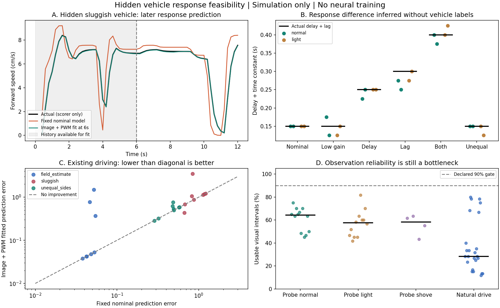

# 영상·PWM만으로 숨긴 차량 응답을 식별할 수 있는가

2026-11-13. 오프라인 시뮬레이션 검증. 대규모 학습과 제어기 교체 없음. 기존 `/goal` 일시중지 유지.

## 판정

**제한된 진단 조건에서는 가능하다. 그러나 기존 주행에 즉시 적용할 수준의 온라인 식별기는 확보하지 못했다.**

영상과 PWM으로 얻은 추정치가 추정에 쓰지 않은 이후 구간의 응답 예측을 개선했다. 따라서 이 입력에 차량 응답을 식별할 정보가 없다는 가설은 이번 시뮬레이터에서는 지지되지 않는다. 반면 일반 주행에서 관측이 자주 거부되고, 받아들인 관측으로 보정한 경우에도 악화가 발생했다. 사전 선언한 채택 기준은 실패했다. 보정값을 제어기에 넣거나 CNN 학습을 시작하지 않는다.

## 입력과 정답의 분리

- 영상 측정기 `FloorMotion`에는 원본 어안 영상, 촬영 시각, 고정 카메라 보정값만 전달한다. PWM, 지도, 실제 위치, 차량 종류는 전달하지 않는다.
- 바닥 특징점을 연속 영상에서 추적하고, 어안 보정과 바닥 평면 투영 후 강체 변환으로 이동량과 회전을 얻는다. 기존 지도 추정기의 PWM 예측 위치를 재사용하지 않는다.
- 응답 추정기에는 위 영상 이동량과 실제 보낸 좌우 PWM 및 전송 시각만 전달한다. 차량 이름·정답 위치·실제 지연·시정수·출력 계수는 별도 채점 파일에 둔다.
- 추정 구조는 순수 지연 + 1차 응답을 가정한다. 지연 0–200ms, 시정수 0–350ms의 72개 후보에서 전진·회전 계수를 강건 회귀로 맞춘다. 기존 명목 모델은 사전값으로 사용한다. **차량 특성을 숨겼다는 것이 동역학 형태와 카메라 기하까지 전혀 모른다는 뜻은 아니다.**
- 15Hz 영상의 3프레임 구간을 합친 0.2초 이동량을 사용한다. 영상 처리 결과는 촬영 70ms 뒤에만 이용 가능하다. 실제 노출시간은 주지 않고, 고정 28ms 노출 중심 근사를 사용한다.
- 2·4·6초에 추정하며, 최종 비교는 6초 추정치를 고정하고 6.2–12초의 응답을 채점한다. 이때 나중에 실제 전송된 PWM을 차례대로 모델에 입력한다. **미래 명령을 모르는 상태에서의 미래 궤적 예측 실험은 아니다.** 추정에는 6초 이후 PWM과 관측을 사용하지 않는다.

특징점 추적과 카메라 보정은 [OpenCV optical-flow 문서](https://docs.opencv.org/4.5.3/dc/d6b/group__video__track.html), [fisheye 문서](https://docs.opencv.org/4.7.0/db/d58/group__calib3d__fisheye.html)에 기반한다. 이 문서들은 함수와 기하 처리의 근거이며, 본 차량의 성능 근거는 아래 실행 결과다.

## 실험 구성

총 52개 사례를 모두 완료했다.

| 구분 | 사례 수 | 내용 |
|---|---:|---|
| 새 진단 입력, 일반 조명 | 12 | 6종 차량 × 새 개발 시드 24001·24002 |
| 새 진단 입력, 강한 조명 | 12 | 위와 같은 실제 궤적, `harsh_light` 영상만 변경 |
| 새 진단 입력, 일시 밀림 | 4 | 정상·sluggish × 2시드, 4.8초에 옆 1.5cm·회전 0.035rad |
| 기존 주행 재분석 | 24 | 기존 4종 코너 × 3종 차량 × 시드 22001·22002 |

숨긴 차량은 정상, 출력 저하(16.8→13.5cm/s/duty), 순수 지연 증가(50→150ms), 시정수 증가(100→250ms), sluggish, 좌우 출력 비대칭이다. 진단 28회 모두 **동일한 PWM 명령열**을 사용한다. 첫 6초에 가감속, 작은 좌우 차동 출력, 정지·재출발을 포함한다. 주행 중 도입하기로 결정한 조작이 아니라 가상 식별 시험 입력이다.

기존 주행 24회는 저장된 실제 PWM·물리 궤적으로 첫 12초의 영상을 15Hz로 다시 렌더링했다. 원래 카메라 기록을 그대로 재생한 것은 아니다. 원본 저장 영상은 약 1Hz여서 지연 식별에 필요한 시간 해상도가 부족했다. 기존 지도 위치 추정치는 사용하지 않았다. 과거 개발 사례 재분석이므로 독립 최종 시험으로 해석하지 않는다.

진단 입력과 기존 주행은 시작 위치·시야·시드도 다르다. 따라서 두 집단의 차이 전체를 PWM의 풍부함만으로 인과 해석할 수 없다. 입력을 바꾸는 것만으로 기존 주행의 문제가 해결됐다는 실험은 아니다.

## 결과

종합 응답 오차는 `sqrt(mean(전진속도오차² + (13 × 회전속도오차)²))`다. 단위는 cm/s 상당이며 완주율, 차선 이탈량 또는 위치 오차가 아니다. 각 행은 에피소드별 오차의 중앙값이다. 개선율 중앙값과 중앙값끼리의 비율은 다를 수 있다.

| 조건 | 기본 모델 → 영상·PWM 추정 모델 | 개선 / 악화 / 유지 | 에피소드별 개선율 중앙값 |
|---|---:|---:|---:|
| 진단·일반 조명 | 0.735 → 0.191 | 10 / 2 / 0 | +73.5% |
| 진단·강한 조명 | 0.735 → 0.268 | 10 / 2 / 0 | +55.6% |
| 기존 주행 | 0.489 → 0.579 | 1 / 8 / 15 | 0% |

진단 일반 조명의 sluggish 2회는 1.366→0.183으로 개선됐다. 정상 차량 2회는 이미 정확한 기본 모델의 0.0198에서 0.1415로 악화됐다. 정상 사례에서 큰 상대 악화율은 작은 기본 오차의 영향도 받지만, 불필요한 보정이 생긴 사실은 그대로다.

일반 조명 진단 12회에서 **지연+시정수 합의 최대 오차는 50ms**, 평균 출력 계수의 절대 상대오차는 중앙값 1.90%, 최대 6.04%였다. sluggish의 실제 합 400ms에 대해 400ms와 375ms를 추정했다. 출력 저하 차량은 실제 13.5에 대해 13.47과 12.69를 추정했다.

순수 지연과 시정수를 각각 정밀하게 분해한 것은 아니다. 예를 들어 정상 차량에서도 비슷한 적합도를 보이는 후보는 지연 50–150ms, 시정수 0–100ms에 걸칠 수 있다. 결과 파일의 `plausible_*`는 최적 손실의 1.2배+0.002 이내 후보 범위이며 통계적으로 보정된 신뢰구간이 아니다. 이번 증거는 개별 물리 파라미터의 확정보다 **유효 응답의 차이와 이후 응답 예측**에 더 강하다.

강한 조명 12쌍과 밀림 4쌍에서 사전 정의한 큰 허위 변화(응답 합 100ms 초과 또는 평균 출력 계수 15% 초과 변화)는 0/16이었다. 하지만 조명만으로 출력 계수가 최대 약 12.1% 달라졌고 관측 가용률도 떨어졌다. “교란을 완전히 구별했다”는 결론은 아니다. 밀림은 1회성 사건이며 지속적인 미끄러짐이나 주행 중 모터 성능 변화는 검증하지 않았다.

## 기존 주행에서 구체적으로 막힌 부분

1. **6초까지 관측이 부족한 사례가 15/24였다.** 최소 8개의 유효 구간을 확보하지 못해 명목 모델을 유지했다. 이것은 식별 성공이 아니다. 특히 북쪽 두 코너의 첫 구간에서 측정 거부가 많았다.
2. **전체 12초 중 사용 가능한 영상 구간은 중앙값 28.3%였다.** 진단 일반 조명에서도 64.2%, 강한 조명에서 57.5%로 선언한 90%에 못 미쳤다. 프레임 수락률과 3프레임 구간 가용률은 별도 값이다.
3. **보정한 9회 중 8회는 이후 예측이 악화됐다.** 전진 속도만 맞아도 회전 응답 계수가 틀릴 수 있다. `natural_19`의 전진 RMSE는 0.112cm/s였지만 회전 RMSE는 0.268rad/s였다. 보정 가능 여부를 단순 관측 개수로 결정하기에 부족하다.
4. 거부 사유를 확인한 대표 사례에서 특징점 자체가 전혀 없는 것이 아니라, 바닥 강체 이동으로 서로 일치하지 않는 점과 잔차가 많았다. 예를 들어 `natural_00` 첫 88개 프레임 쌍 중 29개만 통과했고, 48개는 인라이어 비율, 40개는 잔차 기준을 넘었다(사유 중복). 반사광 등 비강체 영상 움직임의 영향이 의심되지만 광학 요인별 인과 분리는 하지 않았다.

정답 움직임으로 영상 측정만 교체한 **진단 대조군**에서는 기존 sluggish 8회의 오차 중앙값이 기본 0.858에서 0.103으로 줄었다. 같은 수락 구간에 정답 관측을 넣은 대조군도 남은 악화 사례보다 훨씬 나았다. 예를 들어 `natural_19`는 실제 추정 3.481, 같은 수락 구간의 정답 관측 0.078이다. 따라서 이번 실패를 입력 자체의 원천적인 식별 불가능으로만 설명할 수 없다. 영상 이동량의 정확성·가용성과 부정확한 보정의 채택이 구체적인 병목이다. 정답 대조군에서도 모든 정상 사례가 개선된 것은 아니므로 입력의 충분성과 모델 정규화 문제도 남는다.

## 회전 전에 가능한가

6초 시점의 최종 추정을 사용했다. 기준 경로의 곡률이 0.005/cm를 넘는 최초 시점보다 앞선 사례는 12/24뿐이다. 북쪽 경로는 출발 직후부터 아주 약하게 휘어 있으므로 “회전이 전혀 시작되기 전에” 모두 식별했다는 주장은 할 수 없다.

추가 설명용으로 확인한 기준 경로 방향 변화 10° 지점은 6.873–8.925초로, 24회 모두 6초 이후였다. 이 10° 지표는 사후 설명용이며 채택 기준을 바꾼 것이 아니다. 시간 여유가 일부 있어도 실제 추정은 15회가 관측 부족, 8회가 악화였으므로 **본격적인 코너링 전에 유용한 보정이 안정적으로 준비된다는 조건은 충족하지 못했다.**

## 결정과 다음에 해결할 문제

사전 일반 조명 기준 중 10/12 개선, 개선율 중앙값 25% 이상, 응답 합 오차 75ms 이내 10/12 이상은 충족했다. 정상 차량 악화 10% 이내와 영상 구간 가용률 90%는 실패했다. 기존 주행의 sluggish 개선율 중앙값 20% 조건도 실패했다. 기준은 결과를 보고 낮추지 않았다.

다음 작업은 대규모 CNN 학습이 아니라 아래 두 가지의 작은 검증이 타당하다.

- 반사광·일관되지 않는 특징점 때문에 놓치는 측정을 개선하고, 회전 응답을 구별할 수 있는 관측인지 따로 판단한다. 현재의 3프레임 연속 통과 요구로 관측을 과도하게 버리는지도 별도 검증한다. 단순히 거부 기준을 풀어서 측정 수를 늘리는 것은 해결의 증거가 아니다.
- 명목 모델보다 관측을 더 잘 설명한다는 근거와 계수의 식별 가능성이 충분할 때만 보정하며, 불확실하면 기본 모델 또는 모델 범위를 유지한다. 한 후보의 최저 손실만으로 응답 전체를 갈아끼우지 않는다.

짧은 사전 식별 절차의 가능성은 확인됐으나, 위 진단 입력을 실제 주행에 넣거나 정지·재출발을 주행 정책에 채택하지 않았다. 그 절차가 필요한지, 정상 주행만으로 충분한지는 시작 시야·명령을 맞춘 후속 비교가 필요하다.

## 검증 범위와 산출물

- 52개 입력·영상·추정·정답 채점 파일 보존. 일반/강한 조명 12쌍의 물리 궤적 완전 일치.
- 진단 28회의 PWM 명령 완전 일치. 추정기의 입력 스키마에 정답·차량 라벨 없음.
- 미래 PWM·관측을 임의 값으로 바꿔도 6초 추정 결과 동일. 저장 추정 재현 확인.
- 이동·회전 부호를 독립 합성 영상 4쌍에서 확인. 정확한 합성 응답에서 지연·시정수 복원 확인.
- 새 고정 소스와 이전 실험 84개 파일의 해시 변경 없음.
- GPU는 RealCam 영상 렌더링에 사용했다. 특징점 추적과 작은 응답 모델 회귀는 CPU에서 수행했다. CNN/GRU 학습은 없었다.
- 평면 바닥, 정확한 고정 카메라 보정, 이번 1차 응답 계열에 한정한다. 카메라 자세·높이 오차, 전체 harsh 복합 조건, 지속적 출력 변화, 실제 차량, 보정 후 완주율은 미검증이다.

파일: [protocol.json](protocol.json), [scores.json](scores.json), [summary.json](summary.json), [verification.json](verification.json), [artifact_manifest.json](artifact_manifest.json).

원자료: `D:/autodrive_cnn/runs/goal_hidden_response_20261113`.

