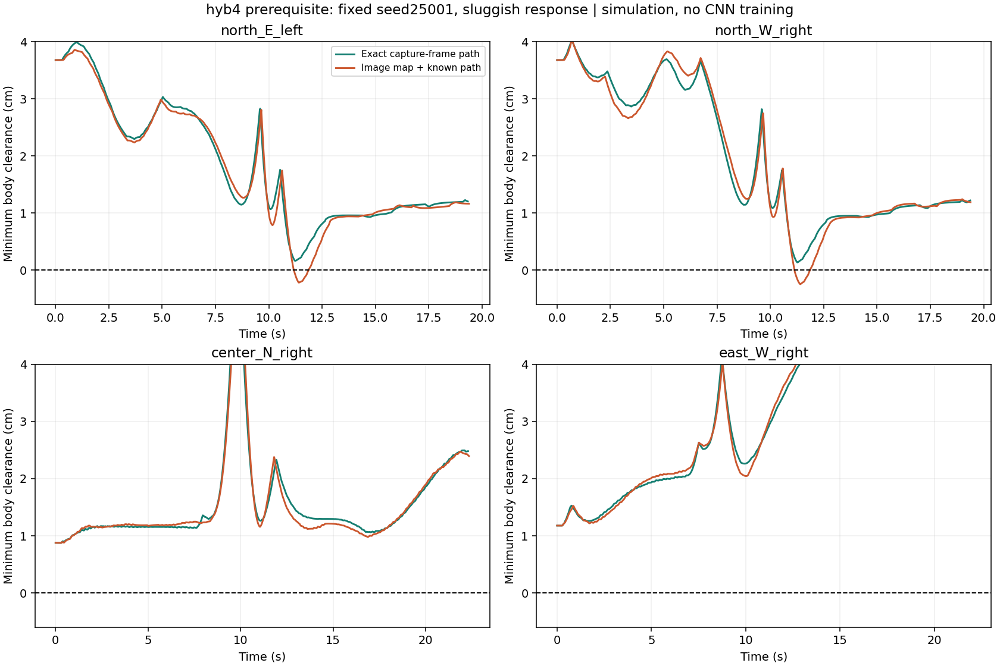

# hyb4 첫 구현과 경로 제어 사전 검증

2026-11-13. **영상 기반 조건이 사전 기준에 미달해 CNN 학습 확대를 보류한다.** 기존 목표의 일시중지 상태와 최종 평가 시드는 유지했다. 이번 실험에는 신경망 학습, 실제 차량 시험, 배포가 없다.

## 질문과 조건

CNN이 차체 상대 경로와 속도를 출력하도록 바꿀 때, 그 출력을 실행할 구동·제어 계층부터 확인했다. 네 이동은 `north/E/left`, `north/W/right`, `center/N/right`, `east/W/right`다. 새 개발 시드 25001/25002와 field_estimate·sluggish·unequal_sides를 조합했다. 각 조건 24회이고, normal 카메라/물리 조건만 사용했다. 일반 도로·28이동·전체 미션·복합 교란 검증이 아니다.

경로는 기존 여유 경로 reference를 사용했다. 48개 점을 0.5cm 간격으로 추출하고, 촬영 좌표계의 오른쪽/앞쪽 cm 단위로 표현한다. 제어기는 차량의 실제 파라미터를 받지 않는다. 명목 gain 16.8, track 13cm, 회전 효율 0.6, 지연 50ms, 응답 시정수 100ms를 사용한다. 예측 시간 275ms는 이전 관측 범위의 중간값으로 사전 고정했다. 출력 문턱 0.36, 부호 있는 시간 평균 할당을 사용한다.

- 정확한 입력 조건: 정답 **촬영 자세**로 경로를 투영하고 36ms 후 제어. 진단용 정답이며 CNN 결과가 아니다.
- 영상 조건: 기존 HSV 지도 추정이 3프레임마다 계산되고 70ms 이후 공개된다. 실제 적용 PWM으로 현재 자세를 예측한 뒤 알려진 전역 경로를 차체 좌표로 투영한다. 실제 자세·속도·차량 파라미터는 제어에 사용하지 않는다. 역회전 근거에 대한 유효성이 미검증인 지도 yaw/floor 자동 학습은 두 지도 사본 모두 비활성화했다.

두 조건의 초기값·사건은 저장된 JSON에서 정확히 일치한다. 다만 촬영 자세/현재 예측 자세 및 경로 timestamp가 다르므로 **관측기만 바꾼 단일 변수 인과 실험은 아니다.** 기존 19/24 pilot과도 시드·제어·학습 설정이 달라 직접적인 성능 향상률을 계산하지 않는다.

## 결과

| 입력 조건 | 정상 응답 | 느린 응답 | 좌우 불균형 | 무이탈 합계 | 올바른 출구 안정 정렬 |
|---|---:|---:|---:|---:|---:|
| 정확한 촬영 자세 + 경로 | 8/8 | 8/8 | 8/8 | 24/24 | 24/24 |
| 영상 추정 + 알려진 경로 | 8/8 | 5/8 | 8/8 | 21/24 | 24/24 |

두 조건 모두 wrong exit 0, severe departure 0, 불필요한 정지 0이다. 최대 20ms 물리 스텝의 각 자세에서 직사각형 차체 전체와 도로 사이의 기하 여유를 검사했고, 출구 도달만으로 무이탈로 세지 않았다. 함수명의 continuous는 차체 형상을 뜻하며 시간 스텝 사이까지 연속 충돌 검사를 했다는 뜻은 아니다. 사전 기준은 22/24 이상 무이탈·24/24 안정 정렬·wrong/severe/불필요 정지 0이다. 정확한 입력 조건만 통과했다.

| 영상 조건 실패 | 시드 | 첫 침범 시각 | 최대 차체 침범 |
|---|---:|---:|---:|
| 북쪽, 동쪽에서 진입, 좌회전, sluggish | 25001 | 11.177s | 2.17mm |
| 북쪽, 서쪽에서 진입, 우회전, sluggish | 25001 | 11.141s | 2.44mm |
| 북쪽, 서쪽에서 진입, 우회전, sluggish | 25002 | 11.321s | 3.16mm |

침범 직전 세 경우 모두 지도 status는 `observed`였다. 차량 진행방향 위치 오차는 약 0.91~0.99cm였다. 최초 침범 이전의 최대 방향 오차는 3.13~4.27도였다. 따라서 지도 정합이 수락됐다는 것만으로 이 코너의 여유를 지킬 만큼 정확하다고 볼 수 없다. 이것이 유일한 원인이라는 증명은 아니다.

정확한 입력 조건도 최악 여유는 약 1.36mm로 작다. 영상 조건의 성공 사례 중에는 약 0.36mm 여유만 남은 사례가 있다. **새 제어기가 해당 경로를 실행할 수 있다는 근거는 생겼지만, 관측 오차·응답 차이를 견딜 여유는 충분하지 않다.**

## 현재 판단

대규모 학습을 먼저 시작하면 이 하위 제어의 민감성과 영상 경로 예측 오차가 다시 섞인다. 이번에는 이 지점에서 확대를 멈춘다. 최종 목표나 허용 침범 기준을 낮추지 않는다.

아직 CNN을 실행하지 않았으므로 인식 CNN의 필요성이나 CNN+GRU의 성능 한계를 판단할 수 없다. 제안한 CNN은 지도 자세로 경로를 투영하는 대신 영상에서 상대 경로를 직접 예측하므로, 이번 영상 지도 조건과 동일한 오차를 낼 것이라고 가정하지 않는다. 다만 학습·평가에서 요구할 경로 오차 예산을 이 결과를 바탕으로 정해야 한다.

다음 개발 판단은 기존 시각 움직임 관측의 활용 가능성과 좁은 여유 구간의 오차 허용도를 확인한 뒤 한다. 이를 위해 학습 범위를 확대하거나 새로운 인식망으로 방향을 바꾸지는 않았다.

## 구현·검사 범위

`hyb4/control.py`, `model.py`, `coordinator.py`를 추가했다. 인터페이스 검사는 부호 있는 역변환/포화, 시간 평균 할당, 실제 PWM receipt와 지연, 경로 timestamp/조향 부호, 재귀 추론 동등성/체크포인트 형식, 일반 도로 출력 보존, 원인별 hold와 교차로 제어권을 다룬 7개 테스트다. 실제 네트워크 가중치는 학습하지 않았고, controller 등록·일반 도로 전환·Pi worker 연결은 미완료다.

근거 파일: 이 폴더의 `protocol.json`, `runs.json`, `summary.json`, `diagnosis.json`과 인접 `hyb4_prerequisite_20261113`의 고정 protocol·결과. 원시 궤적과 적용 명령은 `D:/autodrive_cnn/runs/hyb4_*_prerequisite_20261113` 및 `D:/autodrive_cnn/runs/hyb4_prerequisite_20261113`에 있다. 소스·경로 해시는 protocol에 기록했다.

최초 영상 실험의 마지막 집계에서 tuple/list 표현 비교가 실패했으나 24개 주행 완료 파일은 모두 저장됐다. 같은 고정 프로그램을 완료 파일에서 다시 집계하여 초기값·사건 일치를 확인했다. 추가 주행이나 결과 선별은 하지 않았다.
