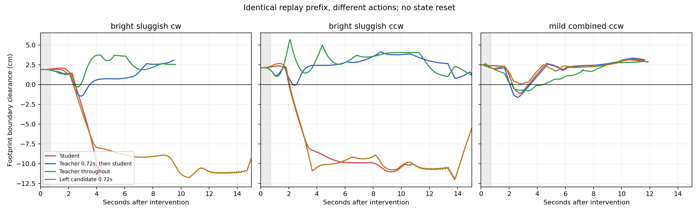

# 복구 진단과 결과 기반 loss 재설계

실행일: 2026-11-12. 진단 21회 + 반시계방향 전체 완주 추적 2회 = **23회 완료**.

## 판단

**교사 출력 오차만으로 주행 품질을 평가하는 목표에는 실제 한계가 있다.** 동일한 실패 직전 상태에서 교사 출력을 잠깐 따르는 것보다 다른 행동이 더 안전한 결과를 낸 사례를 확인했다. 또한 심한 이탈로 끝나던 두 주행 모두 짧은 행동 개입으로 완주하게 만들 수 있었다. 실패 상태가 이미 물리적으로 복구 불가능했던 것은 아니다.

다만 이것이 모든 실패의 원인이 loss라는 뜻은 아니다. 교사의 한계, 학생의 관측 정보, 수집 분포, 제어 지연도 남아 있다. 이번에는 기존 CNN 구조와 direct_v2를 유지한 채 원인을 진단하고, **주행 결과로 행동을 선호하는 loss 시제품과 실제 CNN 역전파 검사**까지 수행했다. 새 모델의 일반화 성능 개선을 검증한 단계는 아니다.

## 동일 상태에서의 개입 결과

두 방식 모두 같은 영상·교란·차체 지연으로 실패 직전까지 재실행했다. 개입 시점에 차체·카메라·지도·출력 할당기 상태를 초기화하지 않았다. 아래 수치는 한 주행 전체의 최소 차체 경계 여유다. 음수는 잠시라도 경계를 침범했다는 뜻이다.

| 조건 | 기존 학생 | 교사 0.72초 후 학생 복귀 | 개입 이후 계속 교사 |
|---|---|---|---|
| 강한 조명 + sluggish + 약한 복합, seed 613 시계 | 실패, −12.048cm | **완주, −1.460cm** | 완주, −0.297cm |
| 같은 조건, seed 613 반시계 | 실패, −12.020cm | **완주, −0.886cm** | **이탈 없이 완주, +0.090cm** |
| 약한 복합, seed 601 반시계 | 완주, −1.086cm | 완주, −1.616cm | 완주, −0.811cm |

세 번째 조건에서는 최초 학생 출력의 왼쪽 조향 성분을 +0.15(정규화 출력 단위) 변경해 0.72초 동안 유지하고 학생으로 돌아온 후보가 **최소 여유 +0.076cm로 이탈 없이 완주**했다. 같은 시점의 교사 개입은 −1.616cm까지 침범했다.

즉, 교사 출력 그 자체를 정답으로 하는 회귀에서는 교사 행동이 오차 0이지만, 그 행동의 이후 결과가 비교 후보 중 최선은 아니었다. 이 사례에서는 교사를 더 정확히 모방하는 것만으로 학습 목표가 충분하지 않다. +0.076cm는 작은 여유이며 실차 안정성을 보증하는 값은 아니다.



그래프는 개입 후 15초 또는 실제 종료까지다. 초록색은 개입 이후 계속 교사, 파란색은 처음 0.72초만 교사다. 반시계방향의 최종 완주 판정은 15초 그림 이후까지 별도로 추적한 결과다. 각 곡선이 종료되면 뒤를 임의로 연장하지 않았다.

## 실험 방법과 검증

- 첫 비교의 세 실패/침범 사례를 진단 목적으로 선택했다. 개입 시작은 각각 시뮬레이션 94초, 57초, 87초다. 모두 최초 침범보다 앞이다. 이 선택 자체가 정답을 사용하므로 배포 가능한 개입 트리거가 아니다.
- 각 상태에서 7개 실행: 학생 유지, 계속 교사, 교사 0.72초, 최초 출력 0.72초 유지, 속도 출력 −0.1, 왼쪽 조향 +0.15, 오른쪽 조향 −0.15. 마지막 네 후보는 최초 정규화 출력을 바꿔 일정하게 유지한다. 나머지 시간에는 원래 학생이 새 영상을 받아 계속 판단한다.
- 0.72초는 36ms 제어 20프레임이다. 지속 교사를 제외한 모든 후보는 그 후 **동일한 고정 학생 정책**으로 돌아간다. 입력 영상은 각 후보의 실제 움직임에 따라 달라진다.
- 교사는 시뮬레이터의 촬영 시점 정답 자세와 기본 차량 파라미터를 아는 진단 전용 기준이다. 출력을 동일한 direct 해석·v4 할당기·지도 가드에 통과시켰다. 실차에 정답 자세를 제공하는 방법을 구현한 것은 아니다.
- 모든 분기의 개입 직전 상태(위치·방향·좌우 속도·명령 큐·차체 변동·난수 상태·이전 명령)와 그 이전 영상/출력/주행 해시가 일치했다.
- 학생 무개입 실행은 원래 240회 실험의 해당 기록과 시간·위치·PWM·진행량·CNN 출력이 프레임별로 정확히 일치했다. 각각 **2,730 / 1,965 / 2,738프레임**을 대조했다.
- 반시계방향 교사 지속/0.72초 개입을 전체 완주까지 추가 실행했다. 두 실행은 먼저 수행한 15초 관찰 실행의 전체 공통 구간과 일치했다. [전체 추적 결과](full_followup.json)
- 실행 시작에 해시를 저장한 진단 코드·모델·bench 핵심 코드 5개 파일은 실행 종료까지 동일했다. [무결성 검사](source_integrity.json)

원시 실행: `D:\autodrive_cnn\runs\recovery_diagnosis_20261112`.
조건과 해시: [protocol.json](protocol.json). 수치와 검증 기록: [summary.json](summary.json).

## 시간 정보에 대한 판단

기존 학생은 단일 영상 입력이므로 이전 프레임과 명령을 직접 사용하지 않는다. 개입 직전 최근 12프레임과 적용 명령·실제 좌우 속도를 함께 보존했다.

보조 민감도 검사에서는 같은 자세와 명령 큐에서 시작하는 차량 복제본의 초기 좌우 속도를 0.6/1.0/1.4배로 바꿨다. 이후 0.5초 이동은 달라졌다. 이는 숨은 운동 상태가 이후 반응에 영향을 준다는 검사이며, 실제 환경의 속도 분포나 다중 프레임 CNN의 우수성을 측정한 것은 아니다. 이 검사는 외부 밀림/출력 이벤트를 재적용하지 않은 별도 차량 동역학 검사다.

**영상 이력을 넣으면 개선되는지는 아직 검증하지 않았다.** 이 실험에서 얻은 세 상황만으로 시간 모델을 학습하고 일반화 성능을 주장할 수 없다. loss의 영향을 분리하기 위해 이번 구현은 모델 구조를 바꾸지 않았다. 이후 시간 입력을 비교할 때도 독립 시드를 사용해야 한다.

## 새 학습 목표

기존 목표는 프레임별 정규화 출력 두 개에 대한 교사 Smooth L1 오차였다. 새 시제품은 **같은 상태에서 갈라진 두 주행 중 이후 결과가 더 좋은 행동 시퀀스를 선호하도록 학습**한다.

### 1. 주행 결과 비용

고정 15초 구간의 비용을 다음처럼 계산한다. 이는 설계 초안의 가중치이며 실차 측정이나 독립 검증으로 최적화된 가중치가 아니다.

```text
C = 100 × 심한 실패
  + 20 × 관찰 종료 시 미복구 경계 침범
  + 10 × 경계 밖 시간 비율
  +  2 × 경계 여유 부족의 시간 평균
  +  1 × 정상 방향 진행 부족
```

- 여유 부족은 `clip((1cm − 경계 여유)/3cm, 0, 1)`을 물리 시간에 대해 적분한다.
- 진행은 목적지까지 직선거리가 아니라 트랙의 정상 주행 방향 진행량이다. 목표량은 `min(4cm/s × 15초, 남은 트랙 거리)`이며 정지하면 진행 부족 비용이 남는다.
- 심한 실패로 조기 종료되면 남은 구간에도 실패 상태의 경계 밖/위험 비용을 적용한다. 일찍 실패해서 짧게 관찰된 것이 유리해지는 문제를 막는다.
- 검증된 완주는 이후 구간에 추가 비용을 넣지 않는다. 단순히 한 바퀴 거리만 채우고 코너/복구 판정을 실패한 경우는 성공으로 흡수하지 않는다.
- 15초 이후 실패 가능성은 이 비용이 직접 알 수 없다. 더 긴 주행 평가를 함께 유지해야 한다.

### 2. 결과를 실제 gradient로 연결

비용 차이가 0.05 이상인 분기 쌍에서 낮은 비용 쪽을 선호 대상으로 정했다. 이번 진단에서는 **39개 선호 쌍**을 얻었다. 세 초기 상태에서 나온 종속 비교들이며, 39개의 독립 실험이나 학습/검증 분할로 취급하면 안 된다.

```text
r(시퀀스) = 개입 20프레임에서 평균(log πθ(행동|해당 영상) − log πref(행동|해당 영상))
Lpref = softplus(−β × (r(좋은 주행) − r(나쁜 주행)))
L = Lpref + λ × 기준 정책과의 변화 제한
```

연속 출력에는 고정 표준편차 `(0.15, 0.20)`의 Gaussian 점수를 사용한다. `β=1`, 변화 제한 가중치 `λ=0.1`이다. 기준 정책은 고정된 direct_v2이며 정답 교사와 같을 것을 요구하지 않는다. 좋은 분기와 나쁜 분기의 **각자 실제 영상**에 해당 분기의 행동을 대응시킨다. 서로 다른 주행의 영상과 행동을 잘못 교차시키지 않는다.

정책 변화 제한은 같은 분기 영상에서 기준 정책과 새 정책의 Gaussian KL로 계산한다. 경계 밖에서 위험한 예측을 했던 기준 정책을 절대 정답으로 고정하는 것이 아니라 과도한 변화에 작은 비용을 두는 것이다.

계속 교사로 달린 분기는 뒤의 정책도 다르므로 짧은 행동 개입의 선호 데이터에서 제외했다. 단일 행동에 0.72초 전체의 결과를 잘못 붙이지 않고, 실제 20개 행동과 해당 영상의 시퀀스 점수로 학습한다.

시뮬레이터 비용은 학습 라벨을 만드는 데 쓰이고, gradient는 시퀀스 행동 점수에서 CNN으로 전달된다. **OpenCV 렌더러나 이산 출력 할당기를 미분하는 구현이 아니다.** 이 Gaussian은 클리핑·디더링 뒤 실제 PWM 확률분포가 아니라 정규화 CNN 출력 공간의 학습용 점수다.

아이디어는 행동 이후 비용을 사용하는 모방학습과 기준 정책 대비 선호 학습을 참고했다. 평균 로그 비율·연속 출력·짧은 개입에 맞춘 프로젝트용 실험적 변형이며 원 논문의 이론적 보장이나 성능을 그대로 주장하지 않는다. [비용을 활용하는 모방학습](https://arxiv.org/abs/1406.5979), [DPO](https://arxiv.org/abs/2305.18290)

### 3. 실제 실행한 검사

- 목표 함수 검사 **7개 통과**: 조기 실패가 유리해지지 않음, 정지보다 정상 진행을 선호함, 완주 후 구간 처리, 미표시 중도 종료 거부, 수치 미분과 역전파 일치, 기준 정책/라벨 gradient 차단, 마스크 처리, 선호 방향으로 업데이트됨. 일부 검사는 한 테스트에서 함께 수행했다.
- 실제 direct_v2 체크포인트를 불러와 세 상황에서 비용 차이가 가장 큰 쌍을 사용했다. 마지막 선형층만 12번 갱신하는 gradient 작동 검사를 실행했다.
- 선호 loss **0.693147 → 0.685750**, 좋은 주행과 나쁜 주행의 상대 점수 차이 **0 → +0.015076**.
- 여기에는 **약한 복합 조건에서 교사 개입보다 비교 조향 후보를 선호하는 쌍**이 포함된다. 새 학습 목표가 무조건 교사에게 가까워지도록 작동하지 않는 것을 실제 입력으로 확인했다.
- 처음 CUDA 비교에서 TF32 정밀도 차이 때문에 ONNX 대조가 기준을 아주 조금 넘었다. TF32를 끄고 FP32로 맞추자 PyTorch/OpenCV 최대 차이는 **3.35e−7**이었다. 허용 기준을 완화하지 않았다.
- 이 12회 업데이트는 loss 작동 검사다. 새 주행 정책을 내보내거나 기존 모델 파일을 교체하지 않았다. 주행 성능 개선 증거로 해석하면 안 된다. [검사 기록](loss_probe.json)

## 구현 및 다음 학습 단계

- `cnn_finetune/recovery_diagnosis.py`: 동일 상태 개입 실험.
- `cnn_finetune/recovery_analyze.py`: 원본 재현 검사, 고정 구간 비용, 선호 쌍 생성.
- `cnn_finetune/trajectory_loss.py`: 결과 비용과 gradient가 연결되는 선호 loss.
- `cnn_finetune/test_trajectory_loss.py`: 목표 함수와 gradient 검사.
- `cnn_finetune/trajectory_loss_probe.py`: 기존 CNN에 연결한 작동 검사.
- `cnn_finetune/recovery_plot.py`: 결과 그래프.

```powershell
Set-Location D:\Projects\AutoMobile\repo
& D:\autodrive_cnn\venv\Scripts\python.exe -m unittest cnn_finetune.test_trajectory_loss -v
& D:\autodrive_cnn\venv\Scripts\python.exe -m cnn_finetune.trajectory_loss_probe --preferences cnn_finetune\results\recovery_diagnosis_20261112\preferences.json --checkpoint D:\autodrive_cnn\checkpoints\dagger_i1_v2\best.pt --out D:\autodrive_cnn\runs\loss_probe_repeat.json
```

다음 본학습은 별도 신규 시드로 복합 교란 주행을 수집하고, 상태/에피소드 단위로 학습·개발·시험을 분리해야 한다. 같은 시작 상태의 모든 분기는 같은 분할에 둔다. 정상 주행·복구 성공·복구 실패·출력 지연·조명 변화를 함께 포함한다. 모델을 갱신한 뒤에는 새 모델로 다시 분기 데이터를 모아 이전 정책의 결과 라벨에만 과적합하지 않도록 한다.

비교는 같은 모델 구조와 같은 수집 데이터를 사용한 기존 모방 loss 대 새 loss부터 시작한다. 모델 선택은 프레임 MAE 대신 별도 개발 시드의 이탈 없는 완주, 심한 실패, 최악 여유, 복구시간으로 한다. 이후 시간 입력을 추가하는 비교는 별도로 분리한다. 현재 seed 601/613과 이번 진단 39쌍은 디버깅 자료이며 독립 시험으로 재사용하지 않는다.
