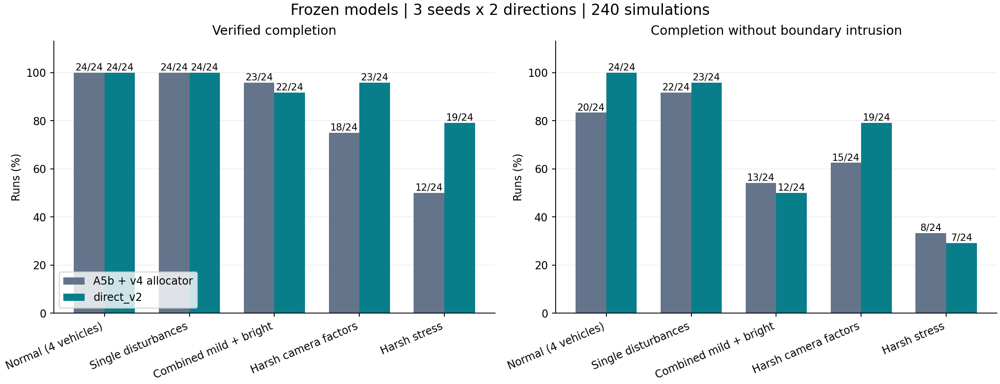
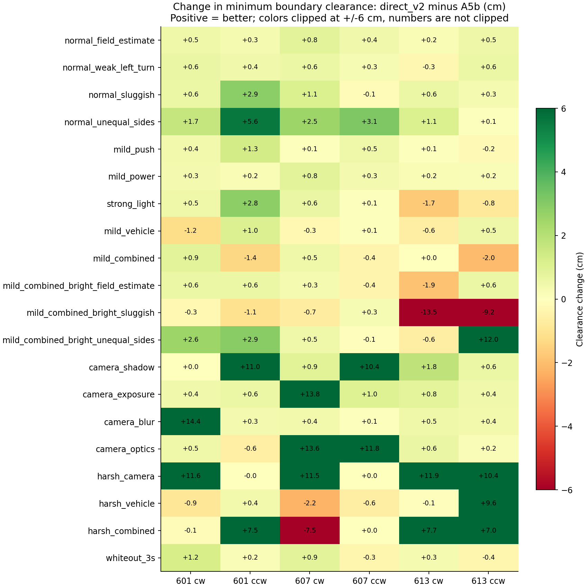

# direct_v2와 A5b + v4 복합 교란 비교

실행일: 2026-11-12. 본 시험 240회(120쌍), 핵심 회귀 조건 재실행 2회 완료.

**direct_v2는 전체 완주와 이탈 없는 완주를 개선했지만, 실제 환경을 의식한 약한 복합 교란에서는 기존 A5b + v4보다 일관되게 좋지 않았다.** 특히 응답 지연이 큰 차체에 약한 밀림·출력 변동·강한 조명이 겹친 조건에서 기존 방식이 완주한 두 사례를 실패했다. 이 결과만으로 기존 방식을 전면 교체하기는 어렵다.

## 비교 결과

각 그룹은 모델당 24회다. ‘이탈 없는 완주’는 검증된 완주이면서 전체 주행의 차체 최소 경계 여유가 0cm 이상인 경우다. 완주에는 경계를 잠시 넘었다가 복귀한 사례도 포함된다.

| 조건군 | A5b + v4 완주 | direct_v2 완주 | A5b + v4 이탈 없는 완주 | direct_v2 이탈 없는 완주 |
|---|---:|---:|---:|---:|
| 기본 환경·차체 4종 | 24/24 | 24/24 | 20/24 | 24/24 |
| 개별 교란 | 24/24 | 24/24 | 22/24 | 23/24 |
| 약한 기계적 복합 교란, 강한 조명 조합 포함 | 23/24 | 22/24 | 13/24 | 12/24 |
| 카메라 요인별 교란 | 18/24 | 23/24 | 15/24 | 19/24 |
| harsh 및 3초 백색 가림 | 12/24 | 19/24 | 8/24 | 7/24 |
| **전체** | **101/120** | **112/120** | **78/120** | **85/120** |



동일 조건·시드·방향의 120쌍에서 direct_v2만 완주한 경우는 14쌍, 기존 방식만 완주한 경우는 3쌍이었다. 이탈 없는 완주는 각각 17쌍 개선, 10쌍 악화했다. 최소 경계 여유의 쌍별 변화 중앙값은 +0.433cm지만, 17쌍에서는 0.5cm 넘게 악화했다. 전체 평균은 이 실험의 조건 구성에 대한 값이며 실제 환경의 발생 확률로 가중한 성공률이 아니다.

## 우선 확인한 복합 교란

약한 복합 교란 24쌍에서는 이탈 없는 완주가 5쌍 개선되고 6쌍 악화했다. 완주는 1쌍 개선, 2쌍 악화했다. 양쪽 모두 성공하고 회복시간을 비교할 수 있는 21쌍에서 코너 후 회복시간 차이의 중앙값은 direct_v2가 **0.324초 더 길었다**. 각 주행에서 얻은 회복시간 중앙값끼리 짝지어 비교했다.

| 복합 조건 (각 모델 6회) | A5b + v4 완주 / 이탈 없는 완주 | direct_v2 완주 / 이탈 없는 완주 |
|---|---:|---:|
| 약한 차체 변동 + 밀림 + 출력 변동 | 6 / 5 | 6 / 4 |
| 위 조합 + 강한 조명, 기본 차체 | 6 / 3 | 6 / 3 |
| 위 조합 + 강한 조명, 응답 지연 차체 | **6 / 4** | **4 / 2** |
| 위 조합 + 강한 조명, 좌우 불균형 차체 | 5 / 1 | 6 / 3 |

‘약한’은 여기서 기계적 교란 강도에 해당한다. `realcam_light`는 강한 조명 요인 프리셋이므로 조명까지 약하다고 해석하면 안 된다.

핵심 회귀는 `mild_combined_bright_sluggish`, seed 613에서 양방향 모두 발생했다.

- 시계방향: 기존 최소 경계 여유 +1.441cm, 이탈 없이 완주. direct_v2는 −12.048cm로 심한 이탈 후 종료.
- 반시계방향: 기존 −2.793cm까지 일시 이탈했으나 완주. direct_v2는 −12.020cm로 심한 이탈 후 종료.
- 시계방향 두 모델을 각각 한 번 더 실행했다. 완주 판정·최소 경계 여유·경계 밖 시간·시뮬레이션 시간·진행 거리가 최초 실행과 정확히 일치했다. 이 2회는 본 시험 240회 통계에 넣지 않았다. [재현 비교](confirmation_comparison.json)

강한 조명이 없는 `mild_combined`, seed 601 반시계방향에서도 기존은 이탈 없이 완주했지만 direct_v2는 −1.086cm까지 잠시 이탈했다. 약한 교란의 결합 자체도 무시할 수 없다.

현재 증거는 조합에서의 성능 회귀를 보여준다. 특정 교란 하나나 CNN 출력 포화가 원인이라고 확정하려면 같은 실패 조건에서 요소를 하나씩 제거하는 추가 실험이 필요하다.

## 실험 설계

- 고정된 두 주행 구성: A5b + `v4` 출력 할당기, `direct_v2` ONNX + direct 출력 해석. 공통 `hyb2` 지도 보정기를 사용했다. CNN 단독 비교가 아니라 두 출력 방식이 포함된 주행 구성 비교다.
- 기본 저장소 커밋: `d2392b774ffae642c0cb7eeace061a660dc0ff01`.
- direct_v2 ONNX SHA-256: `73bcc52551ff7c8f97a4b8a08db72364292eca59c16c0bbe0dc2959cbf7333f4`.
- 시드: 601, 607, 613. 시계/반시계 방향. 20조건 × 3시드 × 2방향 × 2모델 = 240회.
- `bench.run`, `hyb2`, own 36ms 타이밍, 실행당 최대 시뮬레이션 200초, `BENCH_CNN_SPEED=1.0`.
- 모델 재학습이나 파라미터 탐색 없이 비교했다. 시뮬레이터·기존 제어기·모델 원본을 수정하지 않고 별도 실험 어댑터로 외부 교란을 부여했다.
- 모든 120쌍의 카메라·차체·변동·바닥 패치 파라미터와 외부 교란 일정이 같은지 검사했다. 다르게 주행하면 실제 영상과 교란이 발생하는 트랙 위치는 달라진다.

| 외부 교란 | mild | harsh |
|---|---|---|
| 차체 횡방향 밀림 | 좌/우 1–2cm | 좌/우 4–6cm |
| 동시에 발생하는 방향 변화 | ±1–3도 | ±6–10도 |
| 밀림 지속 | 0.3–0.7초에 걸쳐 분산 적용 | 동일 |
| 출력 증감 | ±5–15% | ±20–35% |
| 출력 변동 지속 | 2–5초 | 동일 |
| 이벤트 시작/반복 | 최초 12–17초, 이후 15–25초 간격 | 동일 |

횡방향 밀림과 방향 변화의 부호를 독립적으로 무작위 추출했다. 출력 증감은 모터 명령 이후 시뮬레이터의 속도 응답에 적용했다. 위 크기·빈도는 현장에서 측정한 분포가 아니라 민감도 평가용 가정이다. 밀림은 외력에 의한 위치·방향 변화를 부여하는 방식이며 타이어 접촉 물리 모델은 아니다.

이 외에 기존 `variation=mild/harsh`가 차체 회전 효율, 좌우 출력, 구동 하한, 포화, 지연, 바닥 패치 등의 변동을 제공한다. 카메라 교란은 기존 `realcam` 계열 프리셋을 그대로 사용했다. 정확한 설정과 파일 해시는 [protocol.json](protocol.json)에 보존했다.

## 전체 조건별 결과

각 칸은 **완주 수 / 이탈 없는 완주 수**, 분모는 모두 6이다. 최소 여유는 해당 조건 6회 중 가장 나쁜 값(cm)이다.

| 조건 | A5b + v4 | direct_v2 | A5b 최악 여유 | direct 최악 여유 |
|---|---:|---:|---:|---:|
| normal_field_estimate | 6 / 6 | 6 / 6 | 1.286 | 1.584 |
| normal_weak_left_turn | 6 / 6 | 6 / 6 | 1.356 | 1.800 |
| normal_sluggish | 6 / 5 | 6 / 6 | -1.434 | 1.436 |
| normal_unequal_sides | 6 / 3 | 6 / 6 | -3.902 | 0.416 |
| mild_push | 6 / 5 | 6 / 6 | -0.250 | 0.227 |
| mild_power | 6 / 6 | 6 / 6 | 1.365 | 1.726 |
| strong_light | 6 / 5 | 6 / 5 | -2.386 | -0.719 |
| mild_vehicle | 6 / 6 | 6 / 6 | 0.955 | 0.479 |
| mild_combined | 6 / 5 | 6 / 4 | -0.387 | -1.086 |
| mild_combined_bright_field_estimate | 6 / 3 | 6 / 3 | -1.487 | -0.914 |
| mild_combined_bright_sluggish | 6 / 4 | 4 / 2 | -2.793 | -12.048 |
| mild_combined_bright_unequal_sides | 5 / 1 | 6 / 3 | -12.001 | -1.361 |
| camera_shadow | 4 / 1 | 5 / 3 | -12.080 | -12.062 |
| camera_exposure | 5 / 5 | 6 / 6 | -12.063 | 1.726 |
| camera_blur | 5 / 5 | 6 / 6 | -12.037 | 1.396 |
| camera_optics | 4 / 4 | 6 / 4 | -12.025 | -0.408 |
| harsh_camera | 0 / 0 | 4 / 0 | -12.087 | -12.088 |
| harsh_vehicle | 5 / 2 | 6 / 1 | -12.063 | -2.507 |
| harsh_combined | 1 / 0 | 3 / 0 | -12.124 | -12.119 |
| whiteout_3s | 6 / 6 | 6 / 6 | 0.541 | 1.405 |



## 판정과 해석의 범위

- 검증된 완주는 한 바퀴 완료, 올바른 네 코너 통과, 미복구 경계 이탈이 없는 경우다. 이탈 없는 완주는 추가로 최소 경계 여유 ≥ 0cm를 요구한다. 작은 음수도 이탈로 계산했다.
- 경계 여유 −12cm 미만 또는 차체 전체가 경계 밖으로 나가면 심한 이탈로 조기 종료한다. 따라서 실패 후의 최악 이탈 폭이나 이후 회복 가능성까지 측정한 것은 아니다.
- harsh에서는 direct_v2의 완주가 12→19회로 늘었지만 이탈 없는 완주는 8→7회였다. 심한 교란에서 ‘끝까지 돌아옴’의 개선을 ‘계속 안정적으로 주행함’의 개선과 구분해야 한다.
- 조기 종료된 실패 때문에 전체 경계 밖 시간의 단순 평균은 오해를 줄 수 있다. 회복시간 역시 양쪽 성공 사례를 짝지어 별도 비교했다. 회복은 기존 `compare_metrics`의 코너 후 방향 오차 5도 이내 기준을 사용한다.
- 3개 시드와 한 시뮬레이터에서의 결과다. 실제 차량·센서·전체 임무 검증을 대체하지 않는다.

## 재현 및 기록

실험 코드: `cnn_finetune/robustness_compare.py`, 집계: `robustness_report.py`, 그래프: `robustness_plot.py`.

```powershell
Set-Location D:\Projects\AutoMobile\repo
& D:\autodrive_cnn\venv\Scripts\python.exe -m cnn_finetune.robustness_compare --out D:\autodrive_cnn\runs\robustness_NEW --workers 6
& D:\autodrive_cnn\venv\Scripts\python.exe -m cnn_finetune.robustness_report --root D:\autodrive_cnn\runs\robustness_NEW --out cnn_finetune\results\robustness_NEW
& D:\autodrive_cnn\venv\Scripts\python.exe -m cnn_finetune.robustness_plot cnn_finetune\results\robustness_NEW
```

원시 실행 기록: `D:\autodrive_cnn\runs\robustness_20261112`. 결과 요약은 [summary.json](summary.json), 120쌍별 수치는 [pairs.csv](pairs.csv), 교란 적용 검사는 [pair_checks.json](pair_checks.json)에 있다. 원시 로그·프레임은 이 보고서 폴더에 중복하지 않았다.

첫 실행 중 한 작업이 0프레임 상태에서 네이티브 시작 오류로 종료돼 부분 결과를 `incomplete_attempts`에 보존하고 다시 실행했다. 추가 실행기와 공유한 3개 작업은 기본 실행기가 중복 실행을 피하며 건너뛰었다. 이 때문에 기본 실행기 종료 코드는 1이지만, 재시도와 보조 실행까지 포함한 최종 집계는 **240/240 완료, 누락 0, 120쌍 검증 통과**다. 재시도 기록은 [retry_record.json](retry_record.json)에 있다.

시작 시 해시를 기록한 소스·모델·설정 557개 파일은 종료 시 모두 동일했다. [무결성 검사](source_integrity.json)

다음 개선의 우선 대상은 응답 지연 차체에서 약한 밀림·출력 변동과 강한 조명이 겹치는 경우다. 이번 실패 시드는 디버깅용으로 쓰고, 개선 효과의 최종 평가는 별도의 새 시드로 해야 한다.
