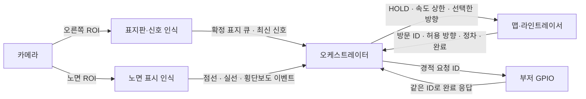

# 라인트레이서 미션 오케스트레이터 연결 규격

세 인식·주행 모듈을 연결하는 노트북용 참조 설계다. `orchestrator.py`는 Python 3.10 이상 표준 라이브러리로 실행한다. 실제 차에 연결할 경계는 카메라 결과, 맵 위치, 라인트레이서 명령·피드백, 부저 명령·피드백이다.

## 팀별 인터페이스



| 담당 | 입력 | 출력과 책임 |
|---|---|---|
| 카메라 | 프레임 1장 | 같은 촬영 번호·단조 시각으로 오른쪽 ROI와 노면 ROI를 공급 |
| 표지판 비전 | 오른쪽 ROI | 위치가 일치하는 반복 관측을 확정한 뒤 `SignSeen`을 관측 큐에 발행. 신호는 시각이 붙은 최신 RED/GREEN/UNKNOWN 상태로 발행 |
| 노면 인식 | 노면 ROI | 자기 진입로의 핑크 점선·횡단보도·출발 실선에 대해 종류, 트랙 ID, 최초 게이트 진입 시각을 발행. 상자 소실과 실제 통과를 구분 |
| 맵/라인트레이서 | 시작 자세, 현재 도로, 진행 방향, 인식 결과 | 현재 접근 중인 점선·갈림길 방문 ID, 중앙/외곽, 허용 방향 집합, 진입 가능 시점, 제동 마지노선, 선 앞 정차 및 출구 진입 확인. 위치 불확실성도 전달 |
| 오케스트레이터 | 확정 관측 큐와 위 상태의 일관된 스냅숏 | 방향 예약, 점선 미션 예약, 신호 상태를 관리하고 한 제어 틱에 최종 주행 요청 하나와 부저 요청을 결정 |
| 라인트레이서 실행부 | FOLLOW / HOLD / TURN, 속도 상한, 명령 ID | 모터 GPIO 소유. 감속·정지·조향을 수행하고 실제 달성 상태와 거절/실패를 회신 |
| GPIO 액션 실행부 | HORN 요청 ID | 부저 GPIO 소유. 설정된 시간만큼 한 번 울리고 펄스 종료 시 완료 회신 |

## 서로 다른 시점에 도착하는 이벤트

한 번의 실행에는 `run_id`, 같은 지점을 다시 지날 때는 새 `visit_id`를 준다. 예를 들어 `run7/P2#1`은 두 번째 점선의 첫 방문, `run7/T3#1`은 세 번째 삼거리의 첫 방문이다. 한 방향 표지판과 한 경적 표지판이 같은 화면에 들어와도 서로 다른 위치를 대상으로 예약할 수 있다.

비전은 표지판이 보일 때 `frame_id, captured_at, object_track_id, kind`를 큐에 보낸다. 연결부는 촬영 당시의 경로와 오른쪽 영역을 대조해 대상 방문 ID를 붙인다. 방향은 경로상 해당 갈림길, STOP·SLOW·HORN은 해당 점선이다. 물리적 표지가 어느 구간 소속인지 확정할 수 없으면 후보 상태로 둔다. 늦게 도착한 프레임을 수신 순간의 다음 교차로에 붙이면 잘못된 방문에서 실행될 수 있다.

오케스트레이터가 관측 큐를 읽어 **방향 예약과 점선 미션 예약을 방문별로 따로 저장**한다. 신호등은 현재 중앙 접근로의 상태로 관리한다. 장면에서 표지판이 사라진 뒤에도 확정 예약은 해당 지점까지 유지한다. 같은 방문·종류의 중복 관측은 하나로 합친다. 한 방문의 같은 종류 슬롯에 서로 다른 지시가 확정되면 CONFLICT로 보류한다. 기본 가정은 점선 한 곳당 수행할 STOP·SLOW·HORN 지시가 하나라는 것이다.

## 어떤 이벤트가 무엇을 실행하는가

| 트리거 | 예약/관측 | 처리 | 완료 기준 |
|---|---|---|---|
| 지정 위치에 배치하고 시작 승인 | 출발 자세, 빨간 실선은 보조 확인 | 맵에서 시작 자세를 한 번 초기화하고 `start_ready` 전달 | 맵 초기화 완료. 주행 중 실선 재검출은 시작 상태를 갱신하지 않음 |
| 일반 갈림길의 선택 시점 | 해당 방문의 LEFT/STRAIGHT/RIGHT | 현재 허용 집합에 있으면 `TURN(방문, 방향)`, 없거나 불명확하면 HOLD | 해당 출구 차선을 다시 잡은 뒤 TURN 완료 회신 |
| 핑크 점선의 상류 ROI 진입 | STOP | HOLD를 유지하고 선 앞에서 실제 정차한 뒤 규정 시간 대기 | 연속 정차·대기 완료 |
| 같은 핑크 트리거 | SLOW | 라인트레이서에 속도 상한과 SLOW ID 전달 | 선 전에 속도 도달 확인. 상한은 명시된 감속 구간 종료까지 유지 |
| 같은 핑크 트리거 | HORN | GPIO 실행부에 HORN ID 전달 | 선 전에 부저 펄스가 끝났다는 회신 |
| 중앙 진입로의 횡단보도 트리거 | 같은 접근로 오른쪽 적색 신호 | 선 앞 HOLD → 실제 정차 → 규정 시간 대기 → 진입점에서 RIGHT | 우회전 출구 확인. 대기 완료 후에는 적색이 계속 보여도 요청한 규칙대로 우회전 |
| 중앙 진입점 | 현재 녹색 신호 | RIGHT가 허용될 때 우회전 | 우회전 출구 확인 |
| 외곽 횡단보도 | 흰 줄 검출 | 주행 상태 유지 | 점선·방향 예약도 그대로 유지 |

중앙 여부는 위치 담당자가 확인한다. 단순히 허용 방향이 세 개이거나 화면에 횡단보도가 있다는 이유로 중앙 규칙을 활성화하지 않는다. 중앙에서 허용 집합에 RIGHT가 없으면 HOLD 후 재확인한다. 일반 갈림길의 방향 지시는 핑크·실선·횡단보도 이벤트를 기다리지 않는다. 외곽의 일반 곡선은 FOLLOW로 라인트레이서가 추종한다.

## 점선이 트리거이면서 마감선인 문제

세 시점을 구분한다. **선이 영상 트리거 ROI에 들어오는 순간**에 동작을 시작한다. **최종 제동 지점**까지 완료가 확인되지 않으면 선 앞에 멈춘다. **차체 앞끝이 실제 점선을 지나는 순간**이 완료 마감이다. ROI는 접근 방향에서 선이 아직 충분히 앞에 있을 때 발동하도록 실제 차량으로 설정한다. 트리거보다 제동 지점을 먼저 만난 경우에는 그 자리에서 대기하고 인식을 복구한다.

보수적인 시작 거리의 예는 `속도 상한 × (최악의 인식·제어 지연 + 동작에 필요한 시간) + 제동거리 + 거리 오차 여유`다. 단위는 cm와 초로 통일한다. 기존 `road_marks/mission_rules.py`의 `braking_gate`는 최종 제동 지점 계산에 활용할 수 있다. 선 거리는 진행 경로를 따라 차체 앞끝에서 가까운 선 가장자리까지 잰다. 감속·제동·부저 시간과 ROI는 팀의 측정값을 넣는다.

엔코더가 없는 차량이므로 STOP·SLOW의 완료 판정에는 영상 이동 또는 실차에서 검증한 별도 확인 방식이 필요하다. PWM을 보낸 순간을 동작 완료로 처리하면 지시를 수행하기 전에 큐가 비워질 수 있다. 넘어갈 때까지 완료 근거가 없으면 실패를 기록하고 HOLD를 유지한다.

## 전달, 우선순위, 복구

1. 인식 워커는 관측만 발행하고, 단일 오케스트레이터가 큐·예약·정지 타이머의 상태를 변경한다. 영상 프레임은 최신 프레임을 사용한다. 진입 트리거·완료 회신은 소비 확인까지 보관한다.
2. 매 틱 건강 상태, 비상정지, 센서 시각, 맵 신뢰도, 명령 수신부 상태를 확인한다. 유효하지 않으면 HOLD를 내고 연속 정차 타이머를 다시 시작한다. 실제 모터 실행부에는 명령 갱신 자체가 끊겼을 때 정지하는 독립 타임아웃이 필요하다.
3. 정지 사유가 하나라도 있으면 HOLD가 일반 추종·회전보다 우선한다. 경적은 정상 상태에서 HOLD와 병행할 수 있다. SLOW 속도 상한은 회전 중에도 적용한다. 한 정지 사유가 해제돼도 남은 사유를 먼저 검사한다.
4. 결정은 매 틱 재전송할 수 있다. TURN은 `방문/TURN`, HORN 및 SLOW는 `방문/종류`로 실행부가 중복 제거한다. 이미 수행 중이면 기존 동작을 이어가고, 완료했으면 같은 완료 응답을 돌려준다. 모터 실행부가 TURN을 거절하거나 수행 중 경로를 잃으면 건강 상태를 통해 정지·재확인한다.
5. 예약의 소유권은 완료까지 오케스트레이터에 있다. 완료된 방문 ID는 이번 주행 동안 재사용하지 않는다. 경로가 취소되어 무효가 된 예약은 연동부가 폐기하고 다른 지점에 전용하지 않는다. 프로세스 재시작은 새 run ID와 정지 상태에서 시작하며 미완료 명령은 자동 재생하지 않는다.

## Python 참조 코드 연결

`Coordinator.step(now, signs=..., pink=..., junction=..., completed=...)`를 제어 주기에 호출한다. 한 틱에 점선과 갈림길 상태를 함께 넣을 수 있다. `Decision.motion`과 `speed_cap`은 라인트레이서, `horn`은 부저 담당자에게 전달한다. `turn`의 첫 원소는 방문 ID이고 SLOW의 완료 ID는 `slow_ids`로 제공한다.

연동부는 같은 구간의 관측이 한두 프레임 사라져도 미완료 방문 컨텍스트를 유지한다. 카메라·맵 어느 쪽에서도 근거를 확보할 수 없으면 `healthy=False`로 전달한다. `Junction.allowed`는 진입 결정을 내리기 직전의 유효 집합이다. 일단 TURN을 수락한 후에는 출구 확인까지 같은 방향을 유지한다.

서로 다른 지시가 한 방문에 확정된 CONFLICT는 참조 구현에서 고정된다. 현장 운영자가 재배치·재시작하거나, 팀에서 명시적인 재식별 절차를 연결한 뒤 해제한다.

설정에는 점선 STOP 정차 시간, 적색 정차 시간, 감속 비율, 새 관측을 받아들일 최대 지연, 제어 틱 최대 공백을 넣는다. 사용자 규칙에서 정하지 않은 값은 코드가 임의로 확정하지 않는다. 부저 지속 시간과 감속 해제 위치도 현장 규칙에 맞춰 연결부에서 지정한다.

노트북 검증 명령

```powershell
py -3.11 -B -m unittest discover -s collaborator -v
```

검증 범위는 이벤트 순서와 판단 로직이다. 실제 GPIO, 카메라 처리 지연, 물리적 제동, 맵 위치 신뢰도는 실차 통합 시험 대상이다.
