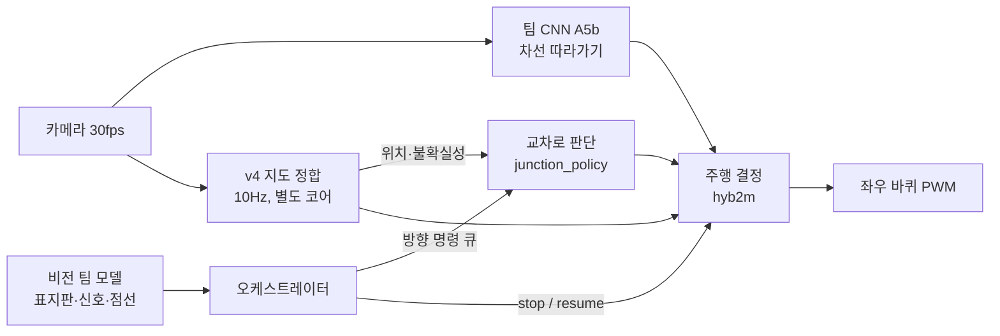

# 주행 코드 설계 개요 — 2026-11-11 (발표용 요약)

자세한 근거와 수치는 [DRIVE_V4_BENCH_20261111.md](DRIVE_V4_BENCH_20261111.md)를 본다. 아래 결과는 모두 **시뮬레이터(bench)** 결과이며, 이 구성으로는 아직 실차를 주행하지 않았다.

## 1. 한 줄 요약

**CNN이 차선을 따라 운전하고, 지도(v4)는 위치를 알려 주며 필요할 때만 끼어든다. 교차로에서는 지도가 정지 위치와 회전량을 정하고 제자리에서 90° 돈다. 방향과 정지 명령은 오케스트레이터가 준다.**

## 2. 구성

| 구성 요소 | 하는 일 | 코드 |
|---|---|---|
| CNN (팀 모델 A5b) | 매 프레임 차선을 따라가는 명령. 조향 경로 약 3.6ms | `bench/controllers.py` TeamCNN |
| v4 지도 | 3프레임에 한 번(10Hz) 바닥 표식으로 지도 위 위치를 추정. Pi에서는 다른 코어를 쓴다는 가정 | `drive_v4/core.py` |
| hyb2 (외곽 주행) | CNN이 운전. 지도는 화면을 잃었을 때와 경계에 가까워졌을 때만 작은 보정 | `HybridCNN` |
| 교차로 판단 | 도착을 스스로 감지 → 갈 수 있는 방향 → 큐의 명령 또는 기본값 | `drive_v4/junction_policy.py` |
| 교차로 통과 (hyb2j) | 제자리 회전 우선. 들어가고 나오는 직선은 CNN, 정지 위치와 회전량은 지도 | `bench/controllers_junction.py` |
| 전체 임무 (hyb2m) | 위 요소를 연결하고 stop/resume 인터럽트를 받음 | `bench/controllers_mission.py` |

## 3. 역할 분담 (오케스트레이터와의 약속)

- **비전과 오케스트레이터:** 표지판·신호등 판독, 분홍 점선과 횡단보도 트리거. stop 표지판이면 정지 → 3초 → 재개를 보낸다.
- **주행 코드:** 명령을 정확하게 실행한다.
  - `push_direction(left/right/straight)`: 표지판 1개에 명령 1개. 다음 교차로에서 쓴다.
  - `stop()` / `resume()`: 즉시 정지와 재개. 회전 도중이어도 그 자리에서 이어 간다.
- **교차로 기본값** (표지판이 없는 교차로가 대부분이므로):

  | 상황 | 명령이 없을 때 |
  |---|---|
  | 외곽 도로에서 삼거리 | 직진 (외곽 유지) |
  | 안쪽 도로에서 외곽 삼거리 | 주행 방향 쪽으로 합류 (시계 방향이면 우회전) |
  | 가운데 사거리 | 항상 우회전 (과목 규칙) |

- **원칙:** 명령이 없거나 불가능한 방향이어도 멈추지 않는다. 주행이 끝나는 것이 가장 큰 감점이기 때문이다.

## 4. 설계에서 정한 것과 근거

1. **CNN을 기본 운전자로 쓴다.** 지도는 조건이 나쁠 때 위치를 크게 틀리면서도 자신 있게 믿는 경우가 있었다. CNN은 차선 가운데를 더 잘 지켰다.
   - 102회 비교에서 선 안 밟은 완주: CNN 우선 합성판 28/34, CNN 단독 23/34, v4 단독 22/34.
2. **교차로는 제자리 90° 회전이 기본이다.**
   - 앞으로만 가며 도는 최소 반경은 약 10.8cm다(바퀴 간격 13cm ÷ (2 × 회전 효율 0.6)).
   - 가운데 사거리 안쪽 도로(18.5·21cm)에서는 원호로 돌면 차체가 선 밖으로 나간다.
   - 조교 의견: 수직으로 들어가 90° 돌아도 된다. 역회전으로 제자리 회전이 되는 것은 실차에서 확인했다.
3. **CNN과 지도를 곡률로 교차 검증하는 방식은 버렸다.** CNN 명령은 차가 덜 도는 만큼 더 꺾는 값이라 도로 곡률과 직접 비교할 수 없다. 192회에서 오히려 나빠졌다.

## 5. 시뮬레이터 결과

시뮬레이터에는 실제 주행 기록으로 맞춘 카메라 효과(반사·그림자·노출·블러), 차량 특성 차이, 화면 상실 같은 교란을 넣었다.

| 시험 | 결과 |
|---|---|
| 동쪽 삼거리 통과 (140회) | 직진 24/24, 좌회전 24/24, 사거리 우회전 43/44를 올바른 출구로 통과. CNN 단독은 좌회전 0/24 (방향 입력이 없음) |
| 전체 임무 (80회, 시계 방향) | 실차 수준 카메라에서 **40/40 완주**, 교차로 순서 모두 맞음 |
| 빨간불 정지 | 24회 모두 횡단보도 앞 1.5cm 이상에서 정지 |
| stop 표지판 | 16회 모두 분홍 점선 앞에서 3초 정지 후 재출발 |

영상 (약 3배속; 왼쪽은 위에서 본 지도, 오른쪽은 차가 본 카메라 화면):
- [남쪽 우회전 → 사거리 빨간불 → 합류](media/1_inner_loop.mp4)
- [서쪽 경로 + 외곽 한 바퀴](media/2_inner_loop_west.mp4)
- [stop 표지판 3초 정지](media/3_stop_sign.mp4)
- [harsh 카메라 외곽 한 바퀴](media/4_lap_harsh.mp4)

## 6. 남은 일 (심사일까지)

- **남쪽 삼거리의 좁은 회전:** 도로 폭이 24cm인데 제자리 회전에는 지름 약 33cm 원이 필요하다. 45°씩 나눠 도는 방식을 검토한다.
- **반시계 방향 임무 시험.**
- **harsh 조건 강화:** 실제보다 가혹한 복합 조건에서는 실패가 남아 있다. CNN 증강 학습을 검토한다.
- **실차 연결:** Pi 실행 코드에 연결하고, 지도 작업자를 별도 코어로 돌리는 구현과 처리 시간 측정이 필요하다.
- **실차 측정:** 제자리 회전의 실제 미끄러짐과 정지 거리를 재서 시뮬레이터 값을 맞춘다.
