# 기존 주행 구조와 CNN 실험의 교체 지점 감사

2026-11-13. 사용자 요청에 따라 현재 로컬 소스의 호출·데이터 흐름을 추적했다. 새 학습·주행 실험·Pi 접속·배포는 하지 않았다. 과거 실차 기록과 현재 Pi 배포 상태는 구분한다.

## 먼저 바로잡을 결론

1. 최근 미세조정 대상 A5b/direct_v2는 **영상에서 주행 명령을 내는 정책 CNN**이다. HSV 도로 인식의 출력을 받아 운전하는 CNN이 아니며, HSV를 교체하는 분할 CNN도 아니다.
2. 기존 구조에는 이미 관측·추정·계획·제어의 분리가 있다. 별도 RoadNet 인식 CNN 실험도 존재한다. 인식 CNN을 새로 제안할 때 이 기존 구조와 연구를 먼저 대조했어야 한다.
3. 새 `FloorMotion`과 기존 `FloorVO`는 **연속 영상에서 차체의 상대 이동·회전을 구한다는 역할이 겹친다.** 새 코드가 없는 기능을 처음 만든 것은 아니다.
4. 다만 존재와 활성 실행 경로는 다르다. v3 Runtime은 FloorVO를 계산하지만, 현재 hyb2/hyb2j/hyb2m의 v4 Driver 경로는 FloorVO를 호출하지 않는다. v4에는 지도 정합을 이용하는 별도 응답 보정 기능이 있다.
5. 새 특징점 실험의 실패는 해당 새 구현의 결과다. 기존 FloorVO, HSV 인식, A5b의 실패를 입증한 비교 실험이 아니다.

## 조사 기준

- 저장소: `D:/Projects/AutoMobile/repo`
- 브랜치: `codex/direct-v2-robustness-20261112`
- HEAD: `d2392b774ffae642c0cb7eeace061a660dc0ff01`; 이후 많은 연구 파일은 미커밋이므로 HEAD만으로 최근 실험을 재현할 수 없다.
- bench가 실제 선택하는 v4: `bench/_vendor/V4_PIN.txt` → `v4_65c68a6613a0`.
- 소스 근거는 아래 파일·함수와 별도 `cnn_finetune/results/architecture_audit_20261113/source_manifest.json`의 해시로 고정했다.
- README의 당시 설명보다 현재 호출 코드·설정값을 우선했다. 소스상 연결을 확인했으며, 이번 감사에서 전체 런타임을 재실행하거나 실차 성능을 검증하지 않았다.

## 1. 이름이 비슷하지만 서로 다른 주행 계열

| 계열 | 주행 판단의 중심 | CNN의 역할 | 관련 소스 |
|---|---|---|---|
| 기존 팀 C안 | 색 대비 경계 → 국소 경로 → 조향 | A5b와 별도 계열 | `docs/PROJECT_CONTEXT.md`, `junction_logic/review_video/` |
| v3 | HSV 관측 → 지도/상태 추정 → 경로 계획 → 제어 | 기본 파이프라인에는 정책 CNN 없음 | `drive_v3/runtime.py` |
| v4 단독 | HSV 국소 차선 추종과 지도 조언을 결합 | 정책 CNN 없음 | `drive_v4/core.py`, pinned 동명 파일 |
| hyb2 | **CNN이 기본 운전**, HSV/v4 지도는 보조 | A5b 또는 direct_v2가 명령 생성 | `bench/controllers.py:HybridCNN` |
| hyb2j | hyb2 + 한 교차로 이동 | 접근·출구에서는 CNN, 회전은 별도 규칙·지도 경로가 개입 | `bench/controllers_junction.py` |
| hyb2m | hyb2j + 교차로 선택·미션·정지/재개 | 일반 도로는 CNN, 교차로와 미션은 상위 상태기계 | `bench/controllers_mission.py` |
| RoadNet 연구 | 도로/비도로/가림 분할 → 경계 → 기존 지도 제어 | **인식 CNN** | `road_ai_v1/kit/train.py`, `road_ai_v1/sim_clean.py` |
| 최근 재귀 정책 연구 | CNN 특징 + PWM 이력 + 방향 → GRU → 좌우 출력 | **시간 정보를 가진 주행 정책** | `cnn_finetune/junction_learning.py`, `goal_mission_actor.py` |

따라서 “기존 Autodrive는 HSV 기반인가 CNN 기반인가”는 하나의 답으로 합치면 안 된다. 현재 A5b+v4 할당기와 direct_v2 비교는 hyb2 계열을 기준으로 한다.

## 2. 현재 비교 기준 hyb2/hyb2m의 실제 흐름

```mermaid
flowchart TD
    I[원본 카메라 영상] --> N[아래 절반 YUV 전처리 + A5b/direct_v2]
    N --> A[출력 의미에 맞는 변환 + v4 모터 할당기]
    I --> H[노출 보정 + HSV/BEV 관측]
    H --> L[국소 차선 경로와 품질]
    H --> M[지도 경계 정합과 자세 추정]
    L --> M
    L --> G[신뢰도·치우침·이탈 보정 판단]
    M --> G
    A --> B[hyb2 기본 출력]
    G --> B
    M --> J[hyb2j/hyb2m 교차로·미션 판단]
    D[방향 예약·정지/재개 명령] --> J
    B --> J
    J --> P[최종 적용 PWM]
    P --> F[실제 적용 시각·PWM 이력]
    F --> M
    M --> R[회전 효율·출발 출력 보정]
    F --> R
    R --> A
```

위 그림은 계열 전체의 역할도다. 외곽 비교 `hyb2`에서는 교차로·미션 계층을 사용하지 않는다. HSV 결과를 CNN 입력으로 넣는 화살표는 없다.

### CNN 경로

`TeamCNN._preprocess/step`은 똑바로 세운 원본 어안 영상의 아래 절반을 YUV·3×3 blur·200×66으로 변환해 ONNX에 넣는다. A5b 출력은 정규화된 `[linear, angular]`이며 도로 마스크·좌우 경계·차량 위치가 아니다.

- **A5b + v4 할당기:** A5b → 팀 DutyMixer → 의도한 평균 듀티·곡률 역산 → v4 `MotorModel.mix`.
- **direct_v2:** 같은 크기의 출력 두 개를 `[평균 듀티/0.66, 좌회전 양의 곡률/0.095]`로 해석 → `_direct_cnn` → v4 `MotorModel.mix`. `required_mixer=direct`가 필수다.
- v4 할당기는 시작 문턱·상한·회전 효율과 낮은 안쪽 바퀴 출력의 시간 평균화를 처리한다. CNN이 아니며 도로를 인식하지 않는다.
- direct_v2는 출력 형태가 A5b와 같아도 **출력 의미가 다르다.** 일반 A5b용 믹서에 그대로 넣는 교체는 올바르지 않다.

근거: `bench/controllers.py:TeamCNN`, `HybridCNN._remap_cnn`, `_direct_cnn`; `cnn_finetune/model.py:LanePolicy`; `cnn_finetune/models/direct_v2/policy.json`.

### HSV·지도 병렬 경로

`HybridCNN`은 pinned v4 `Driver`를 함께 만든다. v4는 노출 보정 후 `Observer.process`로 도로·색 표식·경계 조각 등을 얻고, 국소 경로와 지도 정합을 계산한다. hyb2는 v4가 제안한 PWM을 매번 그대로 쓰지 않는다. CNN 출력을 기본으로 두고 영상이 완전히 소실된 경우의 제한적 지도 주행, 조건부 이탈 보정 등에 사용한다. 지도 계산 주기는 기본 3프레임마다, 모델링된 결과 지연은 70ms다.

실제 적용 PWM은 `on_applied`를 통해 지도 예측에 되돌아간다. Pi runner는 출력 제안과 실제 적용을 구분하고 정지·watchdog으로 0이 적용됐을 때도 이를 전달한다. 주행 명령은 실제 바퀴 속도 측정값이 아니다.

근거: `bench/controllers.py:HybridCNN.step/on_applied/use_map_process`; `bench/pi_run.py`의 `defer_apply`와 `on_applied`; pinned `drive_v4/core.py:Driver.step/applied`.

### 교차로에서 CNN의 권한

A5b/direct_v2에는 좌·우·직진 지시 입력이 없다. `HybridMission`이 지도 추정과 `JunctionPolicy`로 이동 방향을 선택하고, `HybridJunction`이 APPROACH/TRAVERSE/EXIT 및 회전 세부 단계를 처리한다.

`_choose`는 pivot·split·arc를 비교하며, 제자리 회전·나눠 돌기를 선호하는 여유 점수도 있다. 따라서 사용자 지적의 “직각 회전 후 직진”, “일부 회전 후 전진 후 나머지 회전”은 CNN 출력만의 현상이 아니라 **별도 교차로 제어 로직에서 명시적으로 만든 동작**이다. 접근과 일부 IN 단계, 출구에서 CNN이 계속 쓰일 수 있으므로 “교차로 전체에서 CNN이 꺼진다”도 부정확하다.

**A5b만 재학습하면 교차로의 pivot/split 상태기계가 자동으로 부드러운 코너링으로 바뀌는 구조는 아니다.** 부드러운 경로를 누가 선택·추종하고 어느 단계에서 출력을 소유할지 함께 바꿔야 한다.

## 3. 지금까지의 실험이 만드는 CNN의 자리

| 실험 | 입력 → 학습 출력 | 교체·보완하려던 부분 | 확인된 통합 상태 |
|---|---|---|---|
| A5b 미세조정·direct_v2·DAgger | 단일 영상 → 평균 듀티·곡률 | hyb2의 주행 명령 CNN | `BENCH_CNN_ONNX`와 direct mixer로 실행 가능; 실차 채택 아님 |
| A5b+v4 vs direct_v2 복합 교란 비교 | 기존 두 정책을 같은 조건에서 실행 | 위 교체의 폐루프 성능 비교 | `robustness_compare.py`는 `hyb2` 선택; 교차로 상태기계 대체 검증 아님 |
| 부드러운 경로·교사 설계 | 알려진 기하/교사 상태 → 경로·교사 좌우 출력 | 교차로 pivot/split을 대신할 행동과 학습 정답 준비 | CNN 인식 학습 아님 |
| CNN 고정 + GRU/출력부 학습, BC·궤적 선호 loss | CNN 특징1152 + 이전 실제 PWM2 + 방향2 → 좌우 부호 있는 목표 듀티2 | 방향·시간 정보를 갖는 새 주행 정책, 교차로까지 연속 제어하려는 전환 | A5b/direct_v2의 단순 ONNX 교체가 아님 |
| all28 재귀 정책 학습 | 위와 동일 | 모든 교차로 이동의 정책 확대 | 최종 해당 학습은 회전 가중 SmoothL1 BC; 인식/이동량 감독 아님 |
| `ContinuousMissionActor` | 지도로 방향 해석, 영상 특징·PWM·방향으로 정책 출력 | 기존 교차로 직접 제어 대신 연속 재귀 정책을 연결하는 인터페이스 | legacy controller registry 및 하드웨어 진입점에 미등록; 전체 미션 성능 미확인 |
| 알려진 부드러운 경로 추종 pilot | 기존 HSV/지도 추정 자세 + 고정 경로 → 수식 제어·좌우 PWM | 비전 추정+명시적 제어로 구조를 전환할 가능성 확인 | **CNN 미사용·학습 없음** |
| 숨긴 차량 응답 식별 | 새 특징점 영상 이동량 + 실제 PWM 이력 → 지연/시정수/응답 계수 | 차량 상태·응답 추정의 가능성 확인 | **CNN 미사용·학습 없음**, 기존 제어기에 미연결 |

GRU 정책의 `SignedAllocator`는 부호 있는 평균 좌우 듀티를 0 또는 최소 출력 등으로 시간 평균 실현한다. 기존 direct_v2의 “평균 듀티·곡률 → v4 allocator”와 출력 계약이 다르다.

따라서 최근까지 주로 개발한 것은 **주행 정책 CNN/재귀 정책**이다. 최근 두 비신경망 진단 실험은 그 정책의 약점을 조사하다가 분리 구조의 가능성을 확인한 것이지, 인식 CNN이 개선됐거나 필요하다고 판정한 실험이 아니다.

## 4. 기존 움직임 추정과 새 구현의 중복

| 구현 | 관측 근거 | 출력·용도 | 현재 실행 관계 |
|---|---|---|---|
| v3 `FloorVO` | HSV/BEV의 도로·표식·반사 의심 마스크 + LK 특징점 추적 + RANSAC | 상대 이동·회전·잔차 → 위치 예측 대체 후보, 미션 속도/정지 판단, 응답 적응 후보 | v3 Runtime이 매 새 프레임 계산. hyb2의 v4 Driver에서는 호출하지 않음 |
| v3 `ResponseModel.adapt` | FloorVO 이동·회전과 이전 PWM | 전진·좌/우 회전 계수 보정 | `adaptive=false`가 기본; 조건부 연결은 존재 |
| v4 `MapAdvisor`/Estimator | 현재 HSV 경계와 지도의 정합 + PWM 예측 | 전역 자세와 신뢰도 | hyb2 계열의 지도 보조에 사용 |
| v4 `TurnGainLearner` | 신뢰도 높은 연속 지도 yaw 변화 / 적용 PWM의 이상 회전량 | 좌/우 회전 효율을 제한적으로 갱신 | pinned 기본 `enabled=true` |
| v4 `FloorLearner` | 지도에서 본 진행·회전과 PWM 예측 차이 | 정체·한쪽 바퀴 멈춤 증거가 있으면 최소 PWM 상향 | pinned 기본 `enabled=true` |
| 이전 v2 `GainTracker` | 인쇄된 점선/횡단보도 등의 상대 각도 변화 | 회전 예측 계수 | 별도 과거 outer_driver 계열; hyb2의 직접 호출 부품으로 확인되지 않음 |
| 새 `FloorMotion` + `fit_bank` | 원본 영상의 기하 ROI에서 특징점 추적, 바닥 변환 | 상대 이동·회전 → 지연/1차 시정수/출력 계수 추정 | 새 오프라인 진단에서만 사용 |

주의: v3 설정 `use_visual_odometry=false`는 VO 계산 자체가 꺼졌다는 뜻이 아니다. `Runtime.step`은 이를 계산하고 미션 속도·정지 판단에 사용할 수 있다. 해당 설정은 상태 추정의 운동 입력으로 VO를 전달할지 결정한다. 응답 적응에는 별도 `adaptive` 설정이 있다.

### 새 FloorMotion이 기존 FloorVO와 달랐던 점

- 기존 FloorVO는 BEV 영상과 HSV의 도로·표식 마스크를 사용하며, 도로 영역에서 반사 의심점을 제외하고 2차원 특징점 분포도 검사한다.
- 새 FloorMotion은 원본 어안 영상에서 기하 ROI만으로 점을 고르고 바닥 좌표로 변환한다. HSV 도로/반사 마스크를 재사용하지 않았다. 필터 기준·시야·수락 조건도 다르다.
- 지도 자세의 PWM 예측이 섞이지 않는 측정이 필요하다는 목적은 타당하다. 그러나 **기존 FloorVO 자체도 PWM을 입력으로 받지 않으므로, 그 목적만으로 새 추적기가 필요했던 것은 아니다.**
- 새 응답 회귀는 기존 계수 적응에 없던 순수 지연·1차 시정수를 명시적으로 구분하려는 확장이다. 하지만 그 아래 영상 측정기를 새로 만든 부분은 기능 중복이다.
- 기존 FloorVO와 동일 입력 비교를 하지 않았다. 따라서 새 구현의 낮은 가용률을 근거로 기존 HSV·VO가 실패하거나 CNN 인식 교체가 필요하다고 말할 수 없다.

## 5. 앞으로의 개발 범위에 대한 정정

원래 목적은 일반 도로 추종과 교차로의 매끄러운 이동을 개선하는 것이다. 어느 기능을 학습할지 다음처럼 구분해야 한다.

| 목표 | 직접 관련된 교체 지점 | 비교해야 할 기존 기능 |
|---|---|---|
| 일반 도로에서 더 잘 운전 | A5b/direct_v2의 명령 정책 | 기존 정책 + 동일 allocator/지도 보조 |
| 교차로를 매끄럽게 통과 | hyb2j의 회전 단계·경로 제어 또는 이를 대체하는 방향 조건부 정책 | 기존 pivot/split/arc 로직 + 기존 지도 추정 |
| 조명에서 도로 경계를 더 정확히 검출 | Observer의 도로/경계 관측 | HSV, 별도 RoadNet 연구 |
| 차량이 얼마나 움직였는지 추정 | 상대 영상 운동·지도 운동 추정 | FloorVO 및 지도 정합 기반 변화량 |
| 출력 변화·응답 지연 보정 | 응답 모델·계수 갱신·예측 제어 | ResponseModel.adapt, TurnGainLearner, FloorLearner 및 고정 모델 |

인식 CNN 학습은 이 중 세 번째 목표를 선택할 때의 작업이다. 현재 증거만으로 그 선택이 필수라고 결론내리지 않는다. 주행 정책을 개선하던 작업에서 인식 CNN으로 넘어가려면, 무엇을 대체하고 기존 제어기는 무엇을 유지하는지 먼저 명시해야 한다.

다음 비교를 한다면 기존 FloorVO와 새 FloorMotion을 같은 영상·촬영 시각·보정·지연 조건에서 평가하고, 해당 영상 측정을 사용하는 응답 추정의 이득을 따로 평가하는 것이 우선이다. 이는 이번 감사의 권고이며 아직 실행하지 않았다. 기존 지도 기반 응답 보정도 함께 기준선으로 놓되, PWM 예측과 영상 보정이 결합된 추정이라는 점을 표시해야 한다.

## 감사 범위에서 변경한 것

이 문서와 소스 근거 목록만 추가했다. 기존 주행 코드, 모델, 실험 프로토콜·결과는 변경하지 않았다. 일시중지된 목표를 재개하지 않았으며 기존 실험의 불합격 판정을 새로 해석해 합격으로 바꾸지 않았다.
