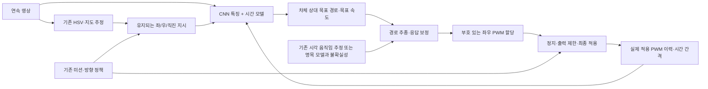

# hyb4: CNN 기반 연속 코너링의 변경 범위

2026-11-13. 기존 코드 구조 감사와 저장된 실험 결과를 기준으로 한 설계 범위 분석이다. hyb4 구현·학습·기존 코드 변경은 아직 하지 않았다. 일시중지된 목표를 재개하거나 완료 기준을 바꾸지 않는다.

## 목표와 권고안

hyb4는 기존의 방향 명령·교차로 규칙·정지/재개·HSV 지도 보조를 유지하면서, 교차로의 pivot/split 실행을 영상 기반 연속 코너링으로 대체하는 새 controller다.

첫 범위는 **일반 도로의 A5b/direct_v2 기준 정책을 보존하고, 교차로 접근부터 출구 정렬까지를 방향 조건부 CNN+시간 모델이 담당**하는 것이다. 전체 도로를 한 번에 새 정책으로 교체할 필요는 없다. 단, 교차로 중심에서만 CNN을 켜면 선행 감속·회전 진입과 출구 복원이 빠지므로 학습·제어 권한 모두 충분한 접근·출구 구간을 포함한다.

추천 출력은 **차체 기준의 짧은 목표 경로와 목표 속도**다. 하위 제어기는 현재 움직임 추정과 실제 PWM 이력으로 이를 추종하고, 부호 있는 좌우 PWM으로 변환한다. 이 구성에서도 어디로 어떻게 코너링할지는 신경망이 결정한다. 단순히 도로 마스크를 만들어 기존 pivot 제어기에 넘기는 인식 CNN이 아니다.

이는 설계 제안이며 성능 우위를 입증한 결과는 아니다. 직접 PWM 정책과의 작은 동일 조건 비교를 통해 선택해야 한다. 기존의 영상 경로 추종 제어기도 아직 개발 기준에 미달하므로 완성된 부품으로 가정하지 않는다.

## 1. 물리적으로 먼저 필요한 변경

현재 direct_v2는 최대 곡률을 0.085/cm로 제한한다. 최소 표현 반경은 약 11.76cm다. v4 `MotorModel.mix`도 안쪽 바퀴를 정지시키거나 0/최소 PWM으로 번갈아 구동하는 전진 중심 할당기이며, 음의 안쪽 바퀴 출력을 만들지 않는다.

반면 `goal_clearance_paths_20261113/geometry.json`의 최근 20개 회전 참조는 최소 반경 2.37–9.33cm다. **20개 모두 어느 구간에서는 direct_v2의 곡률 상한을 넘는다.** 명목 track=13cm, 회전 효율=0.6인 차동 모델에서는 양쪽 바퀴 속도가 모두 0 이상일 때 최소 반경이 약 10.83cm다. 이 계산은 모델 기준이며 실차 한계를 직접 측정한 값은 아니다.

따라서 이 참조를 그대로 사용하려면 **차체의 중심은 전진하되 안쪽 바퀴는 역회전하는 구간**을 허용해야 한다. 제자리에서 차체를 멈춰 돌리는 것과는 다르다. 모든 바퀴 전진까지 요구한다면 해당 참조들을 다시 탐색해야 하며, 그 조건에서 모든 이동이 가능한지는 현재 증거로 알 수 없다. 현재 후보보다 넓은 다른 경로가 존재하지 않는다는 증명도 아니다.

부드러움은 경로의 연속성뿐 아니라 차체 속도·회전속도 변화와 미션상 불필요한 정지로 평가한다. PWM 최소 출발 문턱 때문에 시간 평균 할당이 필요할 수 있으므로 매 프레임 PWM 자체가 매끄러운지를 유일한 지표로 삼지 않는다.

근거: `bench/controllers.py:HybridCNN._direct_cnn`, pinned `drive_v4/core.py:MotorModel.mix/curvature_limits`, `cnn_finetune/results/goal_clearance_paths_20261113/geometry.json`.

## 2. 재사용·교체 목록

| 부분 | hyb4에서의 조치 | 이유·주의 |
|---|---|---|
| 카메라 입력·촬영 시각·실제 PWM 확인 | 인터페이스 재사용 | 처리 지연과 실제 적용 명령 이력이 필요 |
| HSV 관측·지도 정합 | 보존, 보조 역할 명시 | 교차로 도착·출구·방향 규칙에 사용. CNN 입력 앞에 억지로 직렬 연결하지 않음 |
| JunctionPolicy·명령 예약·중앙 우회전 규칙·정지/재개 | 재사용 | 어느 출구로 갈지는 상위 명령/규칙의 책임 |
| 도착·진입·통과·출구 관리 | 재사용 가능한 논리 분리 후 수정 | 지도 기반 진행 판단의 오차, 방향 지시 유지, 재무장 조건을 검증 |
| `_choose`, ROTATE/CREEP/SETTLE 동작 | 정상 코너링 실행 경로에서 교체 | pivot/split 단계가 계속 PWM을 덮어쓰면 CNN 학습으로 대체되지 않음 |
| 일반 도로 정책 | 첫 단계에서는 기존 A5b/direct_v2 유지 | 작업 범위를 교차로로 한정하고 회귀를 줄임 |
| 교차로 CNN | 새 방향 조건부 시퀀스 정책 | 접근·곡선 진입·중간·출구 정렬·밀림 복원을 함께 담당 |
| 경로 추종·응답 모델 | 새 정책 출력에 맞게 연결·검증 | 알려진 경로 pilot도 19/24 vision clean으로 기준 미달; 완료 부품 아님 |
| 모터 할당·속도 예측·이력 | 부호 있는 출력으로 통일 | 기존 양수 전용 velocity/raw_omega/할당 제한을 그대로 쓰면 역회전을 정지로 오해 |
| 기존 지도 기반 gain/floor 학습 | 역회전 구간 처리 검토 | 기존 식과 적용 조건을 검증하기 전에는 부호가 섞인 증거로 자동 갱신하지 않음 |
| 이탈 보정·출력 제한 | 새 출력 계약에 맞게 검토 | 기존 `_add_curvature`는 비음수 clipping을 하므로 그대로 적용하면 필요한 역회전이 사라짐 |
| runner·모델 버전·로그·채점 | hyb4 전용 등록과 계약 추가 | 기존 hyb2 계열과 같은 조건으로 재현 가능한 비교 필요 |

`HybridMission`은 `HybridJunction`을 상속하고 그 실행을 호출한다. 따라서 클래스 이름만 바꾸거나 모델 파일만 교체하는 것으로 충분하지 않다. 새 wrapper에서 순수 방향 정책·지도·명령 채널을 재사용하고, 최종 출력의 소유자를 명시적으로 하나로 정하는 편이 구조를 확인하기 쉽다. 기존 `super().step()`의 명령 기록 부작용을 그대로 물려받아 교차로 출력과 이중 적용하지 않도록 해야 한다.

## 3. CNN이 감당하는 범위: 세 가지 선택

| 방식 | CNN 출력 | CNN이 맡는 부담 | 현재 자산과의 관계 |
|---|---|---|---|
| 인식만 학습 | 도로/경계 또는 상태 | 인식이 중심. 회전 경로·운전은 기존 수식 코드 | HSV/RoadNet 비교에 해당. CNN이 코너링 행동의 기반이라는 목적에는 제한적 |
| **목표 경로+속도 학습 — 권고** | 짧은 차체 상대 경로와 속도 계획 | 영상에서 의도한 출구를 찾아 경로를 만들고, 진입·복원·출구 정렬까지 결정 | 기존 부드러운 참조와 교사 궤적 활용 가능. 새 라벨·출력부·추종기가 필요 |
| 좌우 PWM 직접 학습 | 부호 있는 좌우 목표 듀티 | 위 역할에 더해 차량 응답·지연·조향/출력 변환까지 정책이 흡수 | 최근 GRU 정책을 가장 많이 재사용하지만 실패 원인 분리가 어렵고 기존 후보는 채택 불가 |

권고안에서도 CNN은 가벼운 보조기가 아니다. 다음 네 가지가 핵심 학습 과제다.

1. 영상과 지시에서 목표 출구와 그쪽으로 이어지는 주행 공간을 파악한다. 별도 분할 출력은 필수가 아니며, 필요성이 확인될 때 보조 학습으로 추가한다.
2. 아직 회전하지 않은 접근 구간부터 속도와 회전 진입을 계획한다. 순간 프레임만으로 모호한 부분은 시간 모델이 보완한다.
3. 차체가 밀리거나 방향이 어긋났을 때 현재 상태에서 출구로 복원하는 경로를 만든다. 정상 참조의 다음 점만 복사하는 학습으로 충분하지 않다.
4. 회전 중 보이지 않던 출구를 다시 찾고, 출구 차선과 평행해지는 구간까지 연결한다.

반면 신호/STOP의 실행 규칙, 방향 명령 소비, 전체 지도 좌표의 확정, GPIO, PWM 시작 문턱, watchdog을 신경망에 학습시키는 것은 첫 hyb4 범위에 포함하지 않는다. 차량 응답 파라미터의 정밀 식별도 CNN이 반드시 해결해야 하는 출력으로 강제하지 않는다. 응답 추정이 충분하지 않다면 모델 불확실성을 견디는 제어와 사전 보정 범위를 따로 검증해야 한다.

“CNN이 전체 기능의 몇 %를 맡는다”는 수치는 근거가 없다. 정확한 분담은 **CNN이 국소 주행 의도·경로·속도를, 기존/수정 코드가 미션 규칙·동작 실현·출력 제한을 담당**하는 것이다.

## 4. 제안하는 입출력 계약

- 경로는 전역 정답 위치가 아닌 현재 차체 기준의 짧은 순서 있는 점열로 정의한다. 길이·점 개수는 작은 비교로 결정하며 지금 고정하지 않는다.
- 학습 시 시뮬레이터 정답 자세로 참조를 차체 좌표에 투영해 라벨을 만들 수 있다. 추론 시 그 정답 좌표를 입력하면 안 된다.
- `previous PWM`만으로 충분한지와 명시적인 여러 프레임 이력/시간 간격의 이득을 비교한다. 처리 주기가 바뀌면 프레임 수만으로 지연을 표현하지 않는다.
- 진입 시 선택된 방향은 동일 교차로 통과 동안 유지한다. 직진 지시와 일반 도로 주행의 구분, 활성 상태를 입력에 추가할지는 명시적으로 결정한다. 이는 기존 학생 입력 계약의 변경 제안이지 이미 적용된 변경이 아니다.
- 시간 모델은 제어권을 얻기 전에 실제 관측·적용 명령 이력으로 준비한다. 교차로 중심에서 처음 초기화하거나, 중간에 숨김 상태를 매 프레임 지우지 않는다.
- 일반 도로와 교차로 정책의 전환은 공통 물리 의미의 속도·회전 목표에서 관리한다. 의미가 다른 두 신경망 출력 숫자를 바로 평균내지 않는다.
- 경로/응답의 신뢰도 점수는 별도 검증 대상이다. 점수 출력 하나를 추가하는 것만으로 잘못된 주행이 검출된다고 가정하지 않는다.

## 5. 재사용할 수 있는 자산과 남은 학습

- 20개 회전 참조와 8개 직진 이동이 있다. 최근 여유 경로 교사는 새 개발 시드에서 정상 672/672, 약한 복합 물리 교란 544/672 무이탈을 기록했으나 실제 영상 학생 성능이 아니며 실차 보장도 아니다.
- 최근 28이동 재귀 정책은 84회 정상 비교에서 27회 무이탈, 심한 이탈 21회로 채택하지 않았다. 구조·데이터 로더·평가 코드는 재사용 가능하나 가중치를 완료 모델로 쓸 근거는 없다.
- 442개의 무이탈 시연도 정상 경로 학습의 출발점이지 충분한 복원 데이터라는 뜻은 아니다. 이동별 교란 성공 데이터 공백을 그대로 표시해야 한다.
- 단일 프레임 A5b의 CNN 가중치는 초기값 후보로 사용할 수 있다. 특징부를 계속 고정할지는 별도 비교 사항이다. 새 출력부는 기존 두 출력의 의미를 유지하지 않으므로 단순 파일 교체가 아니다.
- 기존 미션 actor와 방향 resolver는 부분 인터페이스 자산이다. actor의 기존 검사 범위는 네 프레임 추론이며, 전체 미션 완주 검증이 아니다.
- 학습 범위에는 접근→회전→출구의 연결 영상, 속도/응답 차이, 밀림 후 복원, 강한 조명과 약한 복합 교란이 필요하다. 전체 코스의 한 바퀴 영상 없이 고립 교차로만 통과했다고 hyb4 전체 완료로 판단하지 않는다.

목표 경로 오차만 줄여도 완주가 좋아진다고 보장되지 않는다. 보조 목표는 경로·진행 방향·속도·곡률 변화·차체 여유와 복원을 설명하도록 구성하되, 최종 판정은 학생 자신의 출력으로 움직이는 폐루프 결과로 한다. 적분 가능한 단순 모델의 rollout loss는 실제 bench 결과를 대체하지 않는다.

## 6. 구현 범위와 검증 순서

예상 작업은 단일 CNN 파일 수정이 아니라 아래 7개 묶음이다. 정확한 인일·실차 지연은 현재 근거로 산정하지 않는다.

1. **hyb4 wrapper와 실행 계약:** 새 controller 등록, 미션/지도 재사용, 제어권 전환, 적용 PWM 확인. 후보 위치 `bench/controllers_hyb4.py`.
2. **부호 있는 구동 계층:** 목표 속도·회전량→좌우 출력, 문턱/포화, 지도 예측·gain 학습·guard의 부호 일관성. 기존 `SignedAllocator`는 일부 출발점일 뿐 완성된 응답 보정기가 아니다.
3. **경로 추종의 성립 확인:** 정답 상태와 기존 영상 추정 조건을 분리해 급한 참조를 따라갈 수 있는지 검사. 지금의 pilot 실패부터 설명한다.
4. **기존 시각 관측 기준선:** FloorVO, 지도 기반 변화량, 새 FloorMotion을 동일 조건에서 비교. 새 측정기가 실패했다는 이유로 인식 CNN 학습부터 시작하지 않는다.
5. **CNN 출력·데이터·학습:** 방향 조건부 경로/속도 라벨과 복원 데이터, 시간 모델. PWM 직접 출력 기준선도 작은 규모로 유지해 분리 구조의 실제 이득 확인.
6. **연결 주행:** 접근·출구 전환, 방향 예약 유지·소비, 외곽/내부 합류 방향, 필수 정지/재개, 지도 오차에서의 동작.
7. **비교와 채택 판단:** 기존 hyb2m의 실제 pivot/split 운전과 동일 초기값·사건으로 비교. 28이동 및 연결 미션, 무이탈·정확한 출구·회전 부드러움·시간·불필요 정지를 모두 기록. 기존 완료 기준과 최종 시드는 유지.

CNN 관련 작업은 5번에만 한정되지 않는다. 3번에서 출력의 실행 가능성을 보장하고 6·7번에서 새 정책의 폐루프 결과를 검증해야 한다. 반대로 1·2·4번을 CNN 학습으로 대신 해결하려 하면 책임이 다시 섞인다.

## 7. 설계 확정 전에 남은 결정

- “매끄러운 코너링”에 차체 전진 중 안쪽 바퀴 역회전을 허용할지. 현재 참조 유지 여부와 할당기 범위가 달라진다.
- hyb4의 CNN 출력을 목표 경로+속도로 할지, 좌우 PWM으로 할지. 권고는 전자이나 비교 결과가 아직 없다.
- 첫 hyb4 범위를 교차로와 접근·출구에 한정할지, 일반 도로까지 하나의 새 정책으로 바꿀지. 권고는 전자다.

이는 질문에 대한 범위 분석이다. 사용자 결정 없이 위 선택을 구현하거나 새 학습을 시작하지 않았다.

## 참고 근거

- 방향 지시를 조건으로 주행 정책을 학습하는 구성: [End-to-end Driving via Conditional Imitation Learning](https://arxiv.org/abs/1710.02410).
- 경로 출력과 직접 제어 출력의 구분 및 결합 연구: [Trajectory-guided Control Prediction](https://arxiv.org/abs/2206.08129). 해당 차량·환경의 결과를 본 소형 차량 성능으로 환산하지 않는다.
- 로컬 근거: `docs/DRIVING_ARCHITECTURE_AUDIT_20261113.md`, `goal_clearance_validation_20261113/REPORT.md`, `goal_path_following_pilot_20261113/normal_summary.json`, `goal_all_movement_eval_20261113/SEED17_REPORT.md`, `goal_mission_actor_20261113/checks.json`.
